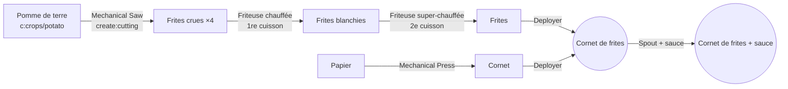
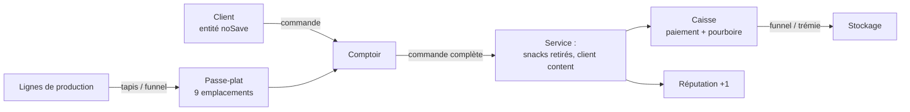
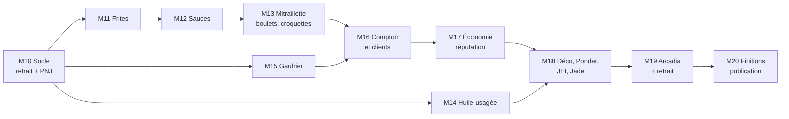

# 13 — Cahier des charges v2

Rédigé le 25/10/2026. Base : la v1 publiée (1.0.0, jalons M0 à M9), le rapport de bug Solonion du 20/10/2026 et les choix de THEFricadelle du 25/10/2026.

La v2 transforme la friterie industrielle en **friterie complète** : frites, sauces, mitraillettes, boulets et gaufres, deux machines de plus, et un comptoir où des clients passent commande. Elle reste sur Arcadia V2 (Minecraft 1.21.1, NeoForge 21.1.x, Create 6.0.10) et garde tous les principes de la v1. Une exigence passe avant tout le reste : **retirer le mod ne doit jamais bloquer une sauvegarde ni un monde.**

Conventions du document :
- **Doit** = exigence ferme, vérifiée par un test ou une checklist. **Devrait** = attendu, abandonnable avec une raison écrite. **Peut** = bonus.
- `⚠️ V-Dn` renvoie à une décision ouverte (section 14). Tant qu'elle n'est pas tranchée, le code prend la valeur provisoire indiquée, configurable.
- Toutes les quantités et durées sont des brouillons d'équilibrage, sauf mention contraire.

---

## 1. Objectifs et non-objectifs

### Objectifs

| # | Objectif | Mesure de réussite |
|---|---|---|
| O1 | Retirer le mod laisse tout monde jouable | Test de retrait (section 3.6) vert en environnement minimal **et** dans Arcadia |
| O2 | Élargir la carte de la friterie belge | Frites, 4 sauces, mitraillette, boulets à la liégeoise, croquettes de crevettes, 2 gaufres : chacun produit par une ligne entièrement automatisable |
| O3 | Ajouter un vrai gameplay de friterie | Un comptoir reçoit des commandes de clients, se sert par tapis ou funnel, encaisse un paiement extractible par funnel |
| O4 | Rester léger sur un serveur de 464 mods | Part du mod sous 1 % du thread serveur dans le scénario spark v2 (section 12.4) |
| O5 | Tout rester réglable sans toucher au jar | Chaque recette, menu, paiement et seuil passe par datapack, tag, loot table ou config serveur |

### Non-objectifs v2

- Pas de changement de version de Minecraft, NeoForge ou Create (cible Arcadia, décidé le 25/10/2026).
- Pas de structure générée dans le monde (friterie de village) : reportée (section 9).
- Pas de métier de villageois : écarté pour la v2, il persiste dans les villageois vanilla et contredit l'exigence de retrait (section 3.3).
- Pas de refonte des 3 paliers de fricadelle : leurs recettes et IDs restent ceux de la v1.

---

## 2. Contraintes

### 2.1 Cible technique (inchangée)

| Clé | Valeur |
|---|---|
| Minecraft / NeoForge | 1.21.1 / 21.1.250 (version du pack au moment du démarrage de la v2, à relire dans `manifest.json`) |
| Create | 6.0.10, range `[6.0.10,6.1.0)` |
| Compat obligatoire | JEI, Jade, KubeJS, toutes optionnelles au runtime |
| Compat souple | Farmer's Delight et addons, Crabber's Delight, Create: Food, Create Diesel Generators, Solonion |

Avant le premier jalon v2 : relire l'instance Arcadia à jour (version du pack, mods ajoutés ou retirés) et mettre à jour `11-compat-arcadia.md` et `gradle.properties` si le pack a bougé.

### 2.2 Principes repris de la v1

1. **Create natif d'abord.** Une machine maison n'entre que si aucune machine de Create ne sait faire l'étape. Chaque machine v2 justifie ce point (section 6).
2. **Automatisable de bout en bout.** Aucun clic droit obligatoire, y compris pour servir un client.
3. **Rien de lourd en tick.** Pas de scan du registre, pas de recherche d'entités chaque tick, caches invalidés par événement.
4. **Compat par tags `c:`** et conditions `neoforge:mod_loaded` / `neoforge:tag_empty`, avec recette de secours vanilla.
5. **IDs de recettes stables et lisibles** : `create_belgian_snacks:<type>/<résultat>`.
6. **Datagen** pour recettes, modèles, blockstates, lang, tags, advancements, loot tables.
7. **Séparation client / serveur stricte**, validée sur `runServer` et `runMultiplayerSmoke`.
8. Chaque chaîne visible en jeu a sa clé en `en_us` et `fr_fr`.

### 2.3 Compatibilité ascendante

- Un monde v1 ouvert en v2 **doit** garder ses Friteuses (graisse comprise), ses Hachoirs (collection et mode), ses items et ses fluides.
- Aucun ID enregistré par la v1 ne disparaît (section 3.2).
- Toute nouvelle clé de config a une valeur par défaut qui reproduit le comportement v1 quand c'est possible. Exception assumée : l'huile usagée (section 6.2), activée par défaut si V-D7 le confirme.

---

## 3. Exigence E1 : retirer le mod sans casser le monde

### 3.1 Le problème

Rapport du 20/10/2026 (reproduit aussi le 28/09/2026) : un joueur mange THE_FRICADELLE, le serveur retire Create: Belgian Snacks, le joueur ne peut plus se connecter. Solonion 1.5.7 garde l'historique des aliments mangés ; au chargement, `create_belgian_snacks:ultimate_fricadelle` devient une pile vide, et `FoodPlayerDataImpl.serializeNBT` lève `IllegalStateException: Cannot encode empty ItemStack`. Le serveur ne place pas le joueur (« Couldn't place player in world »), la config serveur n'est jamais synchronisée, et Pehkui, Arcadia Pets, Ars Nouveau et Mekanism échouent en cascade. En solo, le client plante.

La cause est chez Solonion. Mais tout mod tiers qui stocke nos IDs peut faire pareil, et nos joueurs en paient le prix. La v2 traite donc le risque de notre côté, sur trois plans : ne rien laisser de fragile chez les autres, nettoyer avant un retrait, et prouver le résultat par un test.

### 3.2 Règle R1 : IDs figés

- **Doit** : chaque ID enregistré en v1 reste enregistré en v2, sous le même nom, quel que soit le registre : items, blocs, fluides et leurs types, block entities, entité `the_fricadelle`, data components (`fryer_fluid`, `grinder_contents`), types et serializers de recettes, sons, triggers, advancements, onglet créatif.
- **Doit** : un ID ne se renomme qu'avec un alias de registre NeoForge (`DeferredRegister.addAlias`) de l'ancien vers le nouveau, gardé à vie.
- **Doit** : un test JUnit compare le contenu de chaque registre du mod à une liste figée versionnée (`src/test/resources/frozen-ids.txt`). Un ID absent fait échouer le build. Ajouter un ID met à jour la liste dans le même commit.

### 3.3 Règle R2 : rien de fragile chez les autres

Ce que la v1 respecte déjà (vérifié le 25/10/2026) et que la v2 **doit** garder :

| Élément | Règle | État v1 |
|---|---|---|
| Data components | Posés uniquement sur **nos** items | `fryer_fluid` et `grinder_contents` sur nos blocs-items seulement |
| Data attachments NeoForge | Aucun sur joueurs, mondes, chunks ou entités d'autres mods | Aucun |
| Effets de potion | Effets vanilla uniquement, aucun `MobEffect` maison | Vanilla uniquement |
| Attributs, enchantements | Aucun attribut ni enchantement maison appliqué aux joueurs | Aucun |
| Entités | Toutes `noSave()` : jamais écrites dans un chunk | PNJ `noSave()` |
| Métiers de villageois, POI | Aucun | Aucun |

Toute exception future **doit** être listée ici, avec un test de retrait qui la couvre. Les clients du comptoir (section 7) respectent cette règle par conception : ce sont des entités `noSave()`, la commande vit dans le comptoir.

### 3.4 Règle R3 : un état persistant vit dans nos blocs et nos items

- La réputation du comptoir, la collection du Hachoir, la graisse et l'huile usagée de la Friteuse vivent dans nos block entities, et dans nos blocs-items quand on casse le bloc.
- Au retrait, ces blocs deviennent de l'air et leur état est perdu. C'est le comportement attendu, **documenté** dans le README (section « Retirer le mod »).
- Aucune donnée « globale » (SavedData de monde) sauf nécessité démontrée. Si une est ajoutée, elle porte un nom de fichier à notre namespace, que le jeu ignore sans erreur une fois le mod retiré.

### 3.5 Règle R4 : préparer un retrait

**Commande** `/belgiansnacks uninstall` (op 2), en trois sous-commandes :

| Sous-commande | Effet |
|---|---|
| `scan` | Rapport : nombre de nos items par joueur en ligne (inventaire, ender chest), par conteneur dans les chunks chargés, entrées dans l'historique Solonion, nos fluides dans les réservoirs chargés. Écrit `config/create_belgian_snacks/uninstall_scan.txt`. Ne modifie rien. |
| `purge-references` | Retire nos IDs des données tierces connues et fragiles (Solonion d'abord) pour les joueurs en ligne. Ne touche ni aux inventaires ni aux blocs. |
| `prepare true\|false` | Mode préparation : tant qu'il est actif, chaque joueur qui se connecte passe par `purge-references`. Couvre les joueurs absents le jour de la commande. Écrit dans la config serveur (`uninstall.prepare`). |

**Compat Solonion** (`compat/solonion/`, chargée seulement si Solonion est présent, aucun import dans le code commun) :
- **Doit** : retirer de l'historique de chaque joueur traité toutes les entrées de notre namespace.
- **Doit** : vérifier l'API de Solonion 1.5.7 dans son jar avant d'écrire une ligne (capability ou attachment de l'historique, méthode de retrait). Si aucune API publique ne le permet, passer par l'attachment NeoForge de Solonion en lecture et écriture, isolé dans la classe de compat, et le documenter dans `03-architecture.md`. Pas de mixin sans nécessité démontrée.
- **Ne doit pas** : empêcher Solonion d'enregistrer nos aliments en jeu normal (ce serait changer son équilibrage).

**Procédure documentée** (README bilingue, section « Retirer le mod » / « Removing the mod ») : sauvegarder le monde, `scan`, `prepare true`, laisser passer les joueurs (ou `purge-references` si tous sont en ligne), retirer le jar, relancer.

**En parallèle** : le rapport de bug est transmis à Solonion (correctif suggéré : ignorer les piles vides à la sérialisation et au chargement). Le jour où Solonion le corrige, la compat reste utile pour les versions plus anciennes.

### 3.6 Règle R5 : prouver le retrait par un test

**Outil** `tools/uninstall_smoke.py`, sur le modèle de `arcadia_smoke.py`, en deux environnements :

| Environnement | Contenu | Où |
|---|---|---|
| Minimal | NeoForge + Create + JEI + Jade + notre jar | local, CI si faisable sans affichage |
| Arcadia | copie de l'instance du pack | local, manuel (~40 min) |

**Phase 1, avec le mod** : un monde est peuplé par code de tout ce que la v2 sait produire, dans chaque type de conteneur :

| Conteneur | Ce qu'on y met |
|---|---|
| Inventaire et ender chest du joueur | un exemplaire de chaque item du mod |
| Coffre, tonneau, Depot, tapis, Toolbox, Vault de Create | nos items, dont les blocs-items qui portent un data component |
| Réservoir, Spout, Basin, tuyaux de Create | chacun de nos fluides |
| Filtres et Stock Ticker de Create | un de nos items comme filtre |
| Friteuse, Hachoir, Comptoir posés | en marche, avec état |
| Arcadia seulement : Solonion, Sophisticated Backpacks, AE2 (cellule), Mekanism (réservoir) | un de nos aliments mangé, nos items et fluides stockés |

**Phase 2, sans le mod** : relance avec le même monde, sans notre jar.
- **Doit** : le monde se charge, le joueur est placé, la config serveur se synchronise.
- **Doit** : aucune exception dans le log, hors avertissements « élément de registre inconnu » attendus.
- Arcadia : le scénario Solonion **sans** `purge-references` reproduit le crash connu tant que Solonion n'est pas corrigé (preuve que le test voit le bug) ; **avec** `purge-references` avant le retrait, le joueur se connecte.

**Phase 3, retour du mod** : le jar est remis. Le monde se charge ; nos blocs retirés en phase 2 sont absents (attendu), rien d'autre n'est cassé.

**Aussi** : un monde v1 (1.0.0) ouvert en v2, puis la v2 retirée, passe les mêmes vérifications.

### 3.7 Critères d'acceptation E1

- [ ] `frozen-ids.txt` couvre tous les registres et casse le build sur un ID manquant (vérifié par mutation).
- [ ] Le tableau 3.3 est vérifié par un test (JUnit sur les fichiers générés ou GameTest) : aucun data component de notre namespace sur un item d'un autre namespace, entités `noSave()`.
- [ ] `uninstall_smoke.py` vert en minimal et dans Arcadia.
- [ ] Scénario Solonion : crash sans purge (tant que non corrigé en amont), connexion réussie avec purge.
- [ ] README bilingue : section « Retirer le mod » avec la procédure.

---

## 4. Reprises de la v1

| # | Changement | Détail | Critère |
|---|---|---|---|
| C1 | **PNJ THEFricadelle débranché** | Manger THE_FRICADELLE ne fait plus apparaître le PNJ. Le code reste (entité, renderer, skin, sons, langues) ; seul l'appel `TheFricadelleNpc.appear` est retiré du gag. L'entité reste enregistrée (règle R1). Feu d'artifice, sons, annonce et effets restent. | GameTest : manger THE_FRICADELLE ne crée aucune entité `the_fricadelle` ; les autres gags ont lieu. Le test v1 d'apparition est retiré ou marqué désactivé avec la raison. |
| C2 | Docs alignées sur C1 | `08-decisions-ouvertes.md` (« THEFricadelle en personne »), `10-tests.md` (scénario spark PNJ), page CurseForge, README | Aucune doc ne promet le PNJ |
| C3 | D14 Spice of Life: Onion | Mesurer en jeu l'effet de SoL sur nos aliments, v2 comprise ; ajuster `BSFoods` si une fricadelle devient inutile après 2 repas | Décision notée dans `08` |
| C4 | D15 Create Heat JS | Lister les sources de chaleur que la Friteuse et le Gaufrier acceptent dans le pack à jour | Décision notée dans `08` |
| C5 | Contrôles manuels v1 restés ouverts | Jade dans le pack, SoL compte nos fricadelles, temps du FoodIndex, rendu des lames | Cases cochées dans `10-tests.md` |
| C6 | Branche `dev` en retard sur `main` | Le bump 1.0.1 n'existe que sur `main` (tag `v1.0.1`) ; `dev` affiche encore 1.0.0. Fusionner `main` dans `dev` avant le premier commit v2 | `gradle.properties` identique sur les deux branches |

---

## 5. Nouveaux snacks

Tous nos nouveaux aliments ont le composant `minecraft:food`, rejoignent les tags `c:foods/*` pertinents, et ont un tooltip d'humour en `en_us` et `fr_fr`. Valeurs nutritives dans `BSFoods`, comme la v1.

**Comptent-ils pour le Hachoir ?** Provisoire : **oui** pour les snacks finis de la v2, **non** pour les fricadelles, les pâtes et les intermédiaires (`⚠️ V-D1`). Conséquence à annoncer : dans Arcadia, le total du FoodIndex passe d'environ 1804 à environ 1820, donc un Hachoir en cours en mode ULTIME perd un peu de pourcentage à la mise à jour.

### 5.1 Frites belges (double cuisson)

La vraie frite belge cuit deux fois : une première fois pour cuire l'intérieur (blanchir), puis une seconde, plus chaude, pour la croûte.



| Étape | Machine | Entrée | Sortie | ID de recette |
|---|---|---|---|---|
| Découpe | Mechanical Saw | 1 `#c:crops/potato` | 4 `raw_fries` | `cutting/raw_fries` |
| 1re cuisson | Friteuse **chauffée** | `raw_fries` | `blanched_fries` | `frying/blanched_fries` (100 ticks, 5 mB `#frying_oils` par item) |
| 2e cuisson | Friteuse **super-chauffée** `⚠️ V-D2` | `blanched_fries` | `fries` | `frying/fries` (60 ticks, 5 mB) |
| Cornet | Mechanical Press | 1 `minecraft:paper` | 1 `paper_cone` | `pressing/paper_cone` |
| Mise en cornet | Deployer (tient le cornet) | 1 `#create_belgian_snacks:fries` | `cone_of_fries` | `deploying/cone_of_fries` `⚠️ V-D3` |
| Sauce | Spout, 50 mB d'une sauce | `cone_of_fries` | `cone_of_fries_<sauce>` | `filling/cone_of_fries_<sauce>` |

- Bonus blanc de bœuf : des frites cuites au `melted_beef_tallow` ? Provisoire : non, pas de variante (`⚠️ V-D4`).
- Compat : `fries` rejoint un tag `c:foods/fries` ; nos recettes de cornet lisent `#create_belgian_snacks:fries`, qui contient nos frites et `burgermod:fries` (présent dans Arcadia, entrée optionnelle).
- Secours sans pomme de terre de mod : la pomme de terre vanilla est dans `c:crops/potato`, aucun secours nécessaire.

### 5.2 Sauces (4 nouveaux fluides)

| ID | FR / EN | Couleur | Recette (Mixer) | Condition / secours |
|---|---|---|---|---|
| `andalouse` | Sauce andalouse / Andalouse Sauce | orange `#E8862A` | 250 mB `mayonnaise` + 1 tomate (`c:crops/tomato`) + 1 `belgian_spices` → 250 mB | betterave si tag tomate vide |
| `samourai` | Sauce samouraï / Samurai Sauce | rouge orangé `#D9542B` | 250 mB `mayonnaise` + 1 piment (`#create_belgian_snacks:hot_peppers`) + 1 `belgian_spices`, **chauffé** → 250 mB | secours : poudre de blaze à la place du piment (`⚠️ V-D5`) |
| `americaine` | Sauce américaine / Américaine Sauce | rose `#E89A7A` | 250 mB `mayonnaise` + 50 mB `curry_ketchup` + 1 oignon (`c:crops/onion`) → 300 mB | betterave si tag oignon vide |
| `sauce_lapin` | Sauce lapin / Liège Sauce | brun `#5A3218` | 1 sucre + 1 oignon + 1 baie (`#c:foods/berry`) + 250 mB eau, **chauffé** → 250 mB | betterave si tag oignon vide |

- `#create_belgian_snacks:hot_peppers` : vide par défaut, entrées optionnelles des mods de piment du pack (`mynethersdelight:bullet_pepper` dans Arcadia 2.0.32 ; à compléter par l'export).
- Nouveau tag fluide `create_belgian_snacks:sauces` = les 6 sauces (mayonnaise, curry ketchup et les 4 nouvelles). Sert à la mitraillette.
- Chaque fluide : `still`, `flow` animé, seau dans `c:buckets`, comme la v1.

### 5.3 Mitraillette

Demi-baguette garnie de viande, de frites et de sauce. Le plat le plus belge de la carte.

| Étape | Machine | Détail |
|---|---|---|
| Demi-baguette | Mechanical Saw | 1 `minecraft:bread` → 2 `half_baguette` (`cutting/half_baguette`) |
| Assemblage | Sequenced Assembly, 1 boucle | Entrée `half_baguette`, transition `incomplete_mitraillette` : Deployer viande (`#create_belgian_snacks:mitraillette_meats` = `fricadelle` et `boulet`, extensible par KubeJS) → Deployer `fries` → Spout 100 mB `#create_belgian_snacks:sauces` → `mitraillette` |
| ID | `sequenced_assembly/mitraillette` | 100 % de réussite |

Valeur proposée : 14 de nutrition, saturation 1.2. THE_Fricadelle et THE_FRICADELLE ne sont **pas** dans `mitraillette_meats` (évite de gâcher un palier pour un sandwich).

### 5.4 Boulets à la liégeoise

| Étape | Machine | Détail |
|---|---|---|
| Pâte | Mixer | `#bs:minced_meats/pork` + `#bs:minced_meats/beef` + `#c:bread_crumbs` + 1 oignon → 2 `boulet_paste` (`mixing/boulet_paste`) |
| Mise en forme | Mechanical Press | `boulet_paste` → `raw_boulet` (`pressing/boulet_paste`) |
| Saisie | Friteuse chauffée | `raw_boulet` → `boulet` (`frying/boulet`, 120 ticks, 10 mB) |
| Plat | Mixer **chauffé** | 2 `boulet` + 250 mB `sauce_lapin` + 1 bol → `boulets_liegeois` (`mixing/boulets_liegeois`) ; rend le bol à la consommation |

### 5.5 Croquettes de crevettes grises

| Étape | Machine | Détail |
|---|---|---|
| Farce | Mixer | 2 crevettes (`#create_belgian_snacks:shrimps`) + 250 mB de lait (fluide de NeoForge, activé par Create) + 1 `#c:bread_crumbs` → `shrimp_croquette_mix` |
| Panure | Sequenced Assembly, 1 boucle | Spout 50 mB `mayonnaise` `⚠️ V-D6` (rôle de l'œuf) → Deployer `#c:bread_crumbs` → Press → `raw_shrimp_croquette` |
| Friture | Friteuse chauffée | → `shrimp_croquette` (100 ticks, 10 mB) |

- `#create_belgian_snacks:shrimps` : `crabbersdelight:shrimp` (présent dans Arcadia) en optionnel + tags `c:` de crevettes existants. Sans aucune crevette chargée : recette de secours au cabillaud (`minecraft:cod`), derrière `neoforge:tag_empty`.

### 5.6 Gaufres

| Snack | Chaîne |
|---|---|
| Gaufre de Liège (`liege_waffle`) | Mixer : 1 `create:dough` + 2 sucre + 1 œuf → `liege_waffle_dough` ; **Gaufrier** chauffé → `liege_waffle` |
| Gaufre de Bruxelles (`brussels_waffle`) | Mixer : 1 `create:wheat_flour` + 250 mB de lait (fluide) + 1 œuf → `brussels_waffle_batter` ; **Gaufrier** chauffé → `brussels_waffle` ; Deployer sucre glace (`powdered_sugar`, sucre à la Meule) en option → `brussels_waffle_sugared` |

Les gaufres de Create: Food (`createfood:*_mini_waffle`) ne sont pas touchées ; aucune recette n'entre en conflit (même type de machine, entrées différentes ; à confirmer par le scan des conflits du jalon).

### 5.7 Récapitulatif des nouveaux items

| ID | Mangeable | Remarque |
|---|---|---|
| `raw_fries`, `blanched_fries` | non ⚠️ | Intermédiaires (V-D1 : hors Hachoir) |
| `fries` | oui (petit) | Frites sans cornet |
| `paper_cone` | non | |
| `cone_of_fries` + 6 variantes sauce | oui | `cone_of_fries_mayonnaise`, `_curry_ketchup`, `_andalouse`, `_samourai`, `_americaine`, `_sauce_lapin` ; le cornet ne se rend pas |
| `half_baguette`, `incomplete_mitraillette` | non | |
| `mitraillette` | oui | |
| `boulet_paste`, `raw_boulet` | non | |
| `boulet` | oui | |
| `boulets_liegeois` | oui | bol rendu |
| `shrimp_croquette_mix`, `incomplete_shrimp_croquette`, `raw_shrimp_croquette` | non | |
| `shrimp_croquette` | oui | |
| `liege_waffle_dough`, `brussels_waffle_batter`, `powdered_sugar` | non | |
| `liege_waffle`, `brussels_waffle`, `brussels_waffle_sugared` | oui | |
| `used_oil_filter`, `oil_filter` | non | section 6.2 |

Environ **31 items**, **5 fluides** (4 sauces + huile usagée), **4 blocs** (Gaufrier, Comptoir, enseigne, néon). Les valeurs nutritives de chaque snack sont fixées au jalon qui l'introduit, dans un tableau ajouté à `08-decisions-ouvertes.md`.

---

## 6. Nouvelles machines et mécaniques

### 6.1 Gaufrier (`waffle_iron`)

**Pourquoi une machine** : Create sait cuire en masse (ventilateur sur feu de camp), mais pas mouler une pâte entre deux plaques chaudes avec un temps précis par pièce. Le Gaufrier est aussi l'occasion d'un visuel propre (plaques qui s'ouvrent). Alternative native à trancher : `⚠️ V-D8`.

| Aspect | Spéc |
|---|---|
| Taille | 1 bloc, se pose sur une source de chaleur comme la Friteuse |
| Cinétique | Non |
| Chaleur | Même lecture que la Friteuse (`BasinBlockEntity.getHeatLevelOf`, règles Create + Create Heat JS, aucun `switch` exhaustif) |
| Entrée | 1 slot, 4 pâtes au plus (`waffleIron.maxBatch`) ; funnel, tapis, clic droit ; refuse ce qui n'a pas de recette |
| Sortie | 1 slot, extraction par funnel ou trémie, jamais l'entrée |
| Recette | Nouveau type `create_belgian_snacks:waffle_baking`, même format que `frying` sans fluide (processing recipe Create : ingrédient, résultats avec chances, `processing_time`, `heat_requirement`) ; KubeJS par `event.custom` |
| Cycle | Plaques fermées pendant la cuisson, ouvertes au chargement ; pause sans perte si la chaleur tombe |
| Rendu | Plaque supérieure en modèle partiel animé (Flywheel ou renderer), vapeur ; son de grésillement doux |
| Goggles / Jade | Statut, progression, chaleur |
| Casser | Les items tombent |
| Comparateur | Remplissage de la sortie |
| Craft | Mechanical Crafter : plaques de fer, Precision Mechanism, bassin (provisoire, `⚠️ V-D9`) |

### 6.2 Huile usagée et filtration

Une huile de friterie s'use. En v2, la Friteuse rend une part de la graisse consommée sous forme d'**huile usagée**, qu'il faut évacuer et filtrer.

| Aspect | Spéc |
|---|---|
| Production | À chaque lot, la Friteuse ajoute `fryer.usedOilRatio` × graisse consommée dans un **2e réservoir** interne, sortie seule (provisoire 0.5, `⚠️ V-D7`) |
| Capacité | `fryer.usedOilCapacity` (2000 mB) |
| Blocage | Réservoir d'huile usagée plein → le lot suivant ne démarre pas ; statut « huile usagée à vider » |
| Évacuation | Tuyau ou seau sur la Friteuse ; la capability fluide expose le réservoir d'huile usagée en extraction seulement, le réservoir de graisse en insertion seulement |
| Désactivation | `fryer.usedOilRatio = 0` : comportement v1 exact |
| Monde v1 | Les Friteuses existantes démarrent avec un réservoir d'huile usagée vide |
| Filtration (native) | Mixer : 1000 mB `used_frying_oil` + 1 `oil_filter` → 800 mB `frying_oil` + 1 `used_oil_filter` (`mixing/frying_oil_from_used_oil`) |
| Filtre | `oil_filter` : Mechanical Press de 2 papiers + 1 charbon de bois ; `used_oil_filter` se brûle comme combustible (200 ticks) |
| Compat | Si Create Diesel Generators est chargé : `used_frying_oil` rejoint le tag de biodiesel ou une recette de Mixer vers leur biodiesel (`⚠️ V-D10`, nom exact du fluide à vérifier dans leur jar) |
| Fluide | `used_frying_oil`, brun sombre `#5B4A1E`, pas dans `#frying_oils` |

Le blanc de bœuf fondu suit la même règle (son huile usagée est la même `used_frying_oil`, pour rester simple).

### 6.3 Machines écartées (natif suffisant)

| Idée | Pourquoi pas | Remplacé par |
|---|---|---|
| Coupe-frites | Le Mechanical Saw fait `create:cutting` | `cutting/raw_fries` |
| Distributeur de sauce | Le Spout le fait | recettes `filling` |
| Emballeuse de cornets | Le Deployer le fait | `deploying/cone_of_fries` |
| Filtre à huile motorisé | Le Mixer le fait | `mixing/frying_oil_from_used_oil` |

---

## 7. Gameplay friterie : le Comptoir

### 7.1 Principe

Un **Comptoir de friterie** posé dans une zone éclairée attire des clients pendant la journée. Chaque client passe une commande (1 à 4 snacks). Le Comptoir la sert seul dès que les snacks sont dans son passe-plat : la friterie s'automatise de bout en bout, de la pomme de terre au paiement. Les clients sont de la mise en scène : **la commande vit dans le Comptoir**, jamais dans l'entité.



### 7.2 Comptoir (`friterie_counter`)

| Aspect | Spéc |
|---|---|
| Taille | 1 bloc orientable ; le client se présente devant la face avant |
| Passe-plat | 9 emplacements, insertion par funnel, tapis, trémie, clic droit ; n'accepte que les items du tag `create_belgian_snacks:friterie/servable` (nos snacks finis par défaut) |
| Caisse | 9 emplacements, extraction seule (funnel, trémie, clic droit main vide) ; pleine → plus de nouveau client |
| Commandes | Jusqu'à `counter.maxQueue` (3) en attente, chacune avec son délai de patience |
| Service | Chaque seconde au plus (pas chaque tick), le Comptoir vérifie la commande en tête ; si le passe-plat la contient, il retire les snacks et paie |
| Goggles / Jade | Commande en cours (icônes), patience restante, réputation, file d'attente |
| Écran | Pas de GUI d'inventaire en v2 : le passe-plat et la caisse passent par les capabilities et le clic droit ; la commande s'affiche au-dessus du Comptoir (rendu client) et dans Jade |
| Casser | Le contenu tombe ; la réputation est **conservée** dans l'item (data component `counter_state`, sur notre item uniquement, règle R2) |
| Comparateur | Signal = commandes en attente (0 à 3) × 5 |
| Craft | Mechanical Crafter : planches, Brass Casing, Depot, Clipboard de Create (provisoire, `⚠️ V-D9`) |

### 7.3 Clients (`friterie_customer`)

| Aspect | Spéc |
|---|---|
| Entité | `PathfinderMob` sans IA hostile, invulnérable, sans loot, **`noSave()`** (règle R2) |
| Apparition | À 8 à 24 blocs du Comptoir, sur un bloc où les mobs peuvent apparaître et éclairé, hors de la vue directe du joueur si possible ; seulement le jour (`counter.openHours`) |
| Fréquence | Un essai toutes les `counter.spawnInterval` (provisoire 600 ticks), si la file a de la place ; plafonds `counter.maxCustomersPerCounter` (3) et `counter.maxCustomersPerServer` (30) |
| Trajet | Navigation vanilla vers la face avant ; s'il n'y arrive pas en 30 s, il abandonne et part (la commande n'est pas créée) |
| Commande | Créée **dans le Comptoir** à l'arrivée ; affichée au-dessus du client |
| Patience | `counter.patienceSeconds` (provisoire 180 s) ; à zéro, le client part mécontent, la commande est annulée, réputation −1 |
| Départ | Marche quelques blocs puis disparaît (particules) ; s'il est déchargé avec son chunk, la commande reste valable jusqu'à sa patience |
| Apparence | Skin de villageois varié ou modèle de joueur avec skins inclus (`⚠️ V-D11`) ; aucun skin chargé en ligne |
| Multijoueur | Visible par tous, comportement décidé côté serveur uniquement |

### 7.4 Menu et commandes (data-driven)

- Menu en datapack : `data/<namespace>/friterie_menu/<id>.json`, un fichier par plat proposable.

```json
{
  "item": "create_belgian_snacks:cone_of_fries_andalouse",
  "weight": 10,
  "min_reputation": 0,
  "max_count": 2,
  "price": 3
}
```

- Une commande tire 1 à `1 + réputation / 10` plats (max 4) parmi ceux dont `min_reputation` est atteinte. Les plats d'autres mods peuvent être ajoutés par datapack ou KubeJS : le pack décide.
- Plats par défaut : tous nos snacks finis ; la mitraillette et les boulets à partir de la réputation 10 ; THE_Fricadelle à 30 (rare).

### 7.5 Paiement et réputation

| Aspect | Spéc |
|---|---|
| Paiement | Loot table `create_belgian_snacks:friterie/payment`, appelée avec la somme des `price` de la commande ; par défaut des émeraudes (1 émeraude par 3 points de prix, arrondi au-dessus `⚠️ V-D12`). Le pack peut la remplacer (pièces de Create Numismatics, par exemple) par datapack ou LootJS, sans toucher au jar |
| Pourboire | Servi dans le premier tiers de la patience : loot table `friterie/tip` en plus |
| Réputation | 0 à 50, dans le Comptoir. +1 par commande servie, −1 par client parti mécontent. Débloque des plats plus chers et des commandes plus grandes |
| Étoiles | 5 paliers affichés (0, 10, 20, 35, 50) |
| Advancements | « Première commande », « Coup de feu » (10 commandes servies dans la même journée de jeu), « Friterie étoilée » (réputation 50), « Le client est roi » (commande de 4 plats) |

### 7.6 Décoration

| Bloc | Spéc |
|---|---|
| Enseigne « Friterie » (`friterie_sign`) | Bloc décoratif orientable, texte fixe, variantes FR / NL / EN `⚠️ V-D13` |
| Néon (`friterie_neon`, 4 couleurs) | Bloc lumineux (niveau 15), sans block entity |

Ces blocs ne portent aucun état : au retrait, ils deviennent de l'air.

---

## 8. Configuration serveur (nouvelles clés)

Toutes dans `create_belgian_snacks-server.toml`, synchronisées, avec repli sur la valeur par défaut tant que la config du monde n'est pas chargée (comme la v1).

| Clé | Défaut provisoire | Rôle |
|---|---|---|
| `fryer.usedOilRatio` | `0.5` (V-D7) | Part de la graisse consommée rendue en huile usagée ; 0 = v1 |
| `fryer.usedOilCapacity` | `2000` mB | Réservoir d'huile usagée |
| `waffleIron.maxBatch` | `4` | Pâtes cuites ensemble |
| `waffleIron.speedMultiplier` | `1.0` | Divise les temps de cuisson |
| `counter.enabled` | `true` | Coupe toute apparition de client sur le serveur |
| `counter.spawnInterval` | `600` ticks | Délai entre deux essais d'apparition par Comptoir |
| `counter.maxQueue` | `3` | Commandes en attente par Comptoir |
| `counter.maxCustomersPerCounter` / `maxCustomersPerServer` | `3` / `30` | Plafonds d'entités |
| `counter.patienceSeconds` | `180` | Patience d'un client |
| `counter.openHours` | `day` | `day`, `always` ou `night` |
| `uninstall.prepare` | `false` | Mode préparation au retrait (section 3.5) |

---

## 9. Autres idées (backlog priorisé)

| Priorité | Idée | Note |
|---|---|---|
| Devrait | Schéma KubeJS pour `frying` et `waffle_baking` | Reporté depuis la v1 ; `event.custom` marche déjà |
| Devrait | Scènes Ponder pour le Gaufrier, l'huile usagée, le Comptoir et la ligne de frites | Même méthode que la v1 (schémas construits par `runPonderSchematics`) |
| Devrait | Chapitre FTB Quests « La Friterie » proposé à la team du pack | Livré comme fichier d'exemple dans `docs/`, la team l'intègre ou non |
| Peut | Frites ratées (brûlées) si laissées trop longtemps dans la Friteuse pleine | Contredit D5 (100 % de réussite) : à trancher |
| Peut | Fête de la frite : un jour de jeu sur N, clients doublés et pourboires plus gros | Config, désactivable |
| Peut | Compat .3D Placeable Food (cornets posables) | Si le mod l'expose simplement |
| Peut | Compat upgrade d'alimentation de Sophisticated Backpacks | Vérifier que nos aliments sont mangés |
| Plus tard | Friterie générée dans les villages (jigsaw) | Hors v2 ; sans risque de retrait (blocs seulement) |
| Plus tard | Carbonnade flamande à la bière (`culturaldelights:beer` dans Arcadia) | Recette au Mixer chauffé, simple à ajouter |
| Plus tard | Friteuse industrielle (multibloc) | Seulement si les joueurs saturent les friteuses 1 bloc |
| Écarté | Métier de villageois friturier | Persisté dans les villageois vanilla : contraire à E1 |
| Écarté | Voix des 4 phrases restantes du PNJ | Le PNJ est débranché (C1) |

---

## 10. Compatibilité

| Mod | Exigence v2 |
|---|---|
| JEI | Catégories : Gaufrier (`waffle_baking`), Comptoir (menu : plats, réputation requise, prix) ; Friteuse affiche l'huile usagée rendue ; catalysts enregistrés ; items de transition traités comme en v1 |
| Jade | Gaufrier (statut, progression), Comptoir (commande, patience, réputation), Friteuse (2e réservoir) ; données serveur par le mécanisme de Jade |
| KubeJS | Tous les IDs de recettes stables ; menu en datapack et tags ; paiement en loot table ; test KubeJS du jalon M6.5 étendu : retirer `frying/fries`, ajouter un plat au menu, changer le paiement |
| Farmer's Delight et addons | Oignon, tomate, haché, lait par tags `c:` ; recettes de secours vanilla |
| Crabber's Delight | Crevettes (optionnel, secours cabillaud) |
| Burger Mod | `burgermod:fries` accepté dans le cornet (optionnel) |
| Create Diesel Generators | Huile usagée vers biodiesel (V-D10) |
| Solonion | Compat de purge (section 3.5) |
| Create: Bitterballen | Pas dans Arcadia ; si un jour présent : vérifier les noms affichés « Fries » / « Fryer » et accepter leur huile via `#frying_oils` |
| Polymorph | Scan des conflits refait sur toutes les recettes v2 (Mechanical Crafter et types arbitrés) |

---

## 11. Assets

| Type | Quantité estimée | Note |
|---|---|---|
| Textures d'items 16×16 | ~31 | Placeholders par `tools/gen_placeholders.py`, puis vraies textures par THEFricadelle (`06-assets.md`, `12-prompts-textures.md` à compléter) |
| Fluides | 5 × (still + flow animé) + 5 seaux | Même gabarit que les 4 fluides v1 |
| Blocs | Gaufrier (corps + plaque partielle), Comptoir, enseigne (3 variantes ?), néon (4 couleurs) | Modèles Blockbench faits main, même contrat que la v1 (`models/block/custom/`) |
| Entité | Client : skins ou modèle (V-D11) | Aucun asset de Create ni de Minecraft copié |
| Sons | Gaufrier (fermeture, cuisson), Comptoir (sonnette, caisse), client content / mécontent | Enregistrements CC0 ou faits maison, listés dans `NOTICE.md` |
| Lang | Toutes les nouvelles clés en `en_us` et `fr_fr` ; tooltips d'humour | `ResourceConsistencyTest` couvre déjà la parité |

`tools/asset_status.py` est étendu à chaque nouvel asset attendu.

---

## 12. Tests et critères d'acceptation

### 12.1 Automatisé (à ajouter aux suites existantes)

| Suite | Nouveaux contrats |
|---|---|
| JUnit | `frozen-ids.txt` (R1) ; aucun data component de notre namespace hors de nos items dans les fichiers générés (R2) ; parité des langues ; recettes v2 : IDs exacts, conditions et jumelles de secours ; logique pure du menu (tirage pondéré, réputation, taille de commande) et du paiement |
| GameTest | Double cuisson (chauffé puis super-chauffé, refus de la 2e cuisson sur brûleur chauffé si V-D2 confirmé) ; huile usagée (production, blocage plein, extraction, ratio 0 = v1) ; filtration au Mixer ; Gaufrier (comme la Friteuse : cuit, pause, refus) ; lignes de bout en bout : frites jusqu'au cornet sauce, mitraillette, boulets, croquettes ; Comptoir (commande servie depuis le passe-plat, patience écoulée, réputation, caisse pleine, conservation à la casse) ; clients `noSave()` ; C1 : aucun PNJ |
| GameTest compat (FD) | Recettes tomate / oignon actives, secours inactifs |
| Client smoke | Modèles, fluides, JEI (nouvelles catégories), Ponder (nouvelles scènes), captures du Comptoir avec commande |
| Multijoueur smoke | 2 clients voient le même client et la même commande ; l'un remplit le passe-plat, l'autre voit la commande servie et la caisse se remplir |
| `uninstall_smoke.py` | Section 3.6 |
| Arcadia smoke | Étendu : recettes v2 chargées, conflits, KubeJS, Comptoir en LAN |

Chaque contrat est vérifié par mutation, comme en v1.

### 12.2 Manuel

- Rendu : plaques du Gaufrier, commande au-dessus du Comptoir, néons.
- Ressenti : rythme des clients, patience, valeur du paiement face au coût des lignes.
- Jade dans le pack.

### 12.3 Équilibrage

- Un export `foods export` sur le pack à jour, pour mesurer l'effet de V-D1 sur le total.
- Une session de jeu de 2 heures dans Arcadia avec une friterie de réputation 0 à 20, pour régler `spawnInterval`, `patienceSeconds` et les prix.

### 12.4 Performance (spark)

| Scénario | Mesure | Cible |
|---|---|---|
| 20 Comptoirs servis en continu, 30 clients sur le serveur | `/spark profiler` 2 min | part du mod < 1 % du thread serveur ; aucune recherche d'entités par tick |
| Apparition et départ de 200 clients | `/spark heapsummary` avant / après | `FriterieCustomer` retombe au nombre vivant ; aucune commande orpheline |
| 50 Friteuses avec huile usagée | profiler | coût par tick ≈ v1 |
| 20 Gaufriers | profiler client | rendu des plaques sans pic de frame |
| `/reload` × 10 | heapsummary | instances de menu et de recettes constantes |

Avant la release v2 : rapport spark demandé à THEFricadelle et revu (règle globale), aucune fusion dans `main` avant.

---

## 13. Jalons v2

Même méthode que la v1 : mode plan, implémentation, `build`, `runServer`, checklist, commit. Numérotation à la suite de la v1.



| Jalon | Contenu | Accepté si |
|---|---|---|
| **M10 — Socle** | C6 (fusion `main` → `dev`), C1 (PNJ débranché) et C2, R1 (`frozen-ids.txt`), R2 (test), `uninstall_smoke.py` en minimal, commande `/belgiansnacks uninstall`, compat Solonion | Test de retrait vert en minimal ; PNJ absent ; build cassé par un ID retiré |
| **M11 — Frites** | `raw_fries`, double cuisson, cornet, `cone_of_fries`, recettes, tags `fries` | Une ligne automatique produit des cornets de frites depuis des pommes de terre |
| **M12 — Sauces** | 4 fluides + seaux, recettes et secours, tag `sauces`, cornets sauce | Les 6 cornets sauce sortent d'une ligne ; testé avec et sans FD |
| **M13 — Plats** | Mitraillette, boulets à la liégeoise, croquettes | Chacun produit par une ligne automatique (GameTest) |
| **M14 — Huile usagée** | 2e réservoir, filtre, filtration, compat Diesel | Ratio 0 = comportement v1 exact ; ligne friture + filtration en boucle fermée tient 1 h sans intervention |
| **M15 — Gaufrier** | Bloc, recette `waffle_baking`, rendu, JEI, Jade, 2 gaufres | Checklist Gaufrier en solo et serveur dédié |
| **M16 — Comptoir et clients** | Comptoir, passe-plat, caisse, entité client, commandes, menu datapack | Une friterie entièrement automatique sert 20 commandes d'affilée sans intervention (GameTest) |
| **M17 — Économie** | Paiement en loot table, pourboire, réputation, étoiles, advancements | Réputation de 0 à 10 en jeu ; paiement remplacé par un datapack de test |
| **M18 — Finitions de contenu** | Enseigne, néons, Ponder, catégories JEI, plugins Jade, schéma KubeJS (si fait) | Client smoke et multijoueur smoke verts |
| **M19 — Arcadia** | Arcadia smoke étendu, `uninstall_smoke.py` dans le pack, scénario Solonion, export FoodIndex | Tous verts sur le pack à jour, 2 joueurs en LAN |
| **M20 — Publication** | Textures, sons, rapports spark, README et CHANGELOG bilingues, page CurseForge, procédure de test HTML | Rapports spark revus ; fusion `dev` → `main` ; mise en ligne par THEFricadelle |

---

## 14. Décisions ouvertes v2

À reporter dans `08-decisions-ouvertes.md` au fil des jalons, avec la date.

| # | Question | Proposition provisoire |
|---|---|---|
| V-D1 | Nos snacks v2 comptent-ils pour le Hachoir ? | Oui pour les snacks finis, non pour fricadelles, pâtes et intermédiaires |
| V-D2 | 2e cuisson des frites : super-chauffée ou chauffée ? | Super-chauffée (fidèle à la double cuisson, mais demande du blaze cake) ; repli : chauffée avec un temps plus long |
| V-D3 | Ratio frites → cornet | 1 frite + 1 cornet → 1 cornet de frites (le Deployer ne prend qu'un item) |
| V-D4 | Frites au blanc de bœuf : variante meilleure ? | Non |
| V-D5 | Samouraï sans piment dans le pack | Poudre de blaze en secours |
| V-D6 | Croquettes : mayonnaise ou œuf pour la panure ? | Mayonnaise (un fluide passe au Spout, un œuf demanderait un Deployer de plus) |
| V-D7 | Huile usagée : activée par défaut ? Quel ratio ? | Oui, 0.5 |
| V-D8 | Gaufrier maison ou cuisson native au ventilateur ? | Gaufrier maison |
| V-D9 | Recettes de craft du Gaufrier et du Comptoir | Voir sections 6.1 et 7.2 |
| V-D10 | Huile usagée vers biodiesel de Diesel Generators | Recette de Mixer si leur fluide existe, sinon rien |
| V-D11 | Apparence des clients | Modèle de joueur avec 6 skins inclus, faits par THEFricadelle |
| V-D12 | Barème du paiement | 1 émeraude par 3 points de prix |
| V-D13 | Langue de l'enseigne | 3 variantes : « Friterie » (FR), « Frituur » (NL), « Chip shop » (EN) |
| V-D14 | Le nom affiché du mod change-t-il (« Belgian Snacks » couvre déjà la carte) ? | Non |
| V-D15 | Les frites ratées (brûlées) entrent-elles en v2 ? | Non (section 9) |
