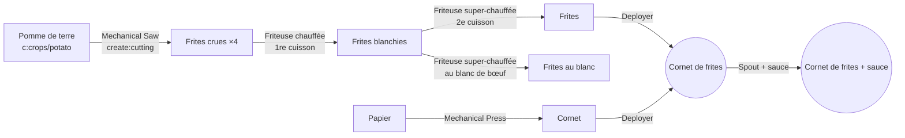
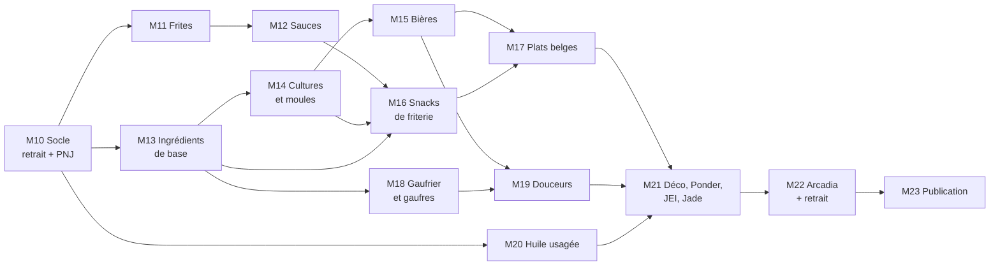

# 13 — Cahier des charges v2

Rédigé le 25/10/2026. Base : la v1 publiée (1.0.0, jalons M0 à M9), le rapport de bug Solonion du 20/10/2026 et les choix de THEFricadelle du 25/10/2026.

La v2 transforme la friterie industrielle en **cuisine belge complète** : frites, sauces, snacks de friterie, plats, douceurs et gaufres, avec leurs ingrédients (chicons, asperges, choux de Bruxelles, poireaux, sarrasin, moutarde, houblon, moules, sirop de Liège, fromage de Herve, jambon d'Ardenne, bières de cuisine), un Gaufrier, l'huile usagée à filtrer et de quoi décorer sa friterie. La vente passe par les boutiques de Create 6 (Stock Keeper et nappes), sans code de notre côté. Elle reste sur Arcadia V2 (Minecraft 1.21.1, NeoForge 21.1.x, Create 6.0.10) et garde tous les principes de la v1. Une exigence passe avant tout le reste : **retirer le mod ne doit jamais bloquer une sauvegarde ni un monde.**

Conventions du document :
- **Doit** = exigence ferme, vérifiée par un test ou une checklist. **Devrait** = attendu, abandonnable avec une raison écrite. **Peut** = bonus.
- `V-Dn` renvoie à une décision v2 (section 14), toutes tranchées le 25/10/2026.
- Toutes les quantités et durées sont des brouillons d'équilibrage, sauf mention contraire.

---

## 1. Objectifs et non-objectifs

### Objectifs

| # | Objectif | Mesure de réussite |
|---|---|---|
| O1 | Retirer le mod laisse tout monde jouable | Test de retrait (section 3.6) vert en environnement minimal **et** dans Arcadia |
| O2 | Coller au nom : une vraie carte belge | 111 aliments finis (section 5) : friterie, plats, douceurs, gaufres ; chacun produit par une ligne entièrement automatisable, ingrédients compris |
| O3 | Pouvoir tenir une friterie avec Create | Nos snacks se vendent dans une boutique Create 6 (Stock Keeper + nappe) sans réglage particulier ; décor de friterie disponible |
| O4 | Rester léger sur un serveur de 464 mods | Part du mod sous 1 % du thread serveur dans le scénario spark v2 (section 12.4) |
| O5 | Tout rester réglable sans toucher au jar | Chaque recette et chaque seuil passe par datapack, tag ou config serveur |

### Non-objectifs v2

- Pas de changement de version de Minecraft, NeoForge ou Create (cible Arcadia, décidé le 25/10/2026).
- Pas de structure générée dans le monde (friterie de village) : reportée (section 9).
- Pas de métier de villageois : écarté pour la v2, il persiste dans les villageois vanilla et contredit l'exigence de retrait (section 3.3).
- Pas de comptoir ni de clients maison : Create 6 sait déjà tenir une boutique (retiré le 25/10/2026).
- Pas de boisson alcoolisée consommable : les bières sont des fluides de cuisine (décidé le 25/10/2026).
- Pas de refonte des 3 paliers de fricadelle : leurs recettes et IDs restent ceux de la v1.

---

## 2. Contraintes

### 2.1 Cible technique (inchangée)

| Clé | Valeur |
|---|---|
| Minecraft / NeoForge | 1.21.1 / 21.1.250 (version du pack au moment du démarrage de la v2, à relire dans `manifest.json`) |
| Create | 6.0.10, range `[6.0.10,6.1.0)` |
| Compat obligatoire | JEI, Jade, KubeJS, toutes optionnelles au runtime |
| Compat souple | Farmer's Delight et addons, Crabber's Delight, Create: Food, Create Diesel Generators, Solonion |

Avant le premier jalon v2 : relire l'instance Arcadia à jour (version du pack, mods ajoutés ou retirés) et mettre à jour `11-compat-arcadia.md` et `gradle.properties` si le pack a bougé.

### 2.2 Principes repris de la v1

1. **Create natif d'abord.** Une machine maison n'entre que si aucune machine de Create ne sait faire l'étape. Chaque machine v2 justifie ce point (section 6).
2. **Automatisable de bout en bout.** Aucun clic droit obligatoire.
3. **Rien de lourd en tick.** Pas de scan du registre, pas de recherche d'entités chaque tick, caches invalidés par événement.
4. **Compat par tags `c:`** et conditions `neoforge:mod_loaded` / `neoforge:tag_empty`, avec recette de secours vanilla.
5. **IDs de recettes stables et lisibles** : `create_belgian_snacks:<type>/<résultat>`.
6. **Datagen** pour recettes, modèles, blockstates, lang, tags, advancements, loot tables.
7. **Séparation client / serveur stricte**, validée sur `runServer` et `runMultiplayerSmoke`.
8. Chaque chaîne visible en jeu a sa clé en `en_us` et `fr_fr`.
9. **Aucune marque déposée** dans les noms ou les IDs (Bicky, Kipcorn, Poulycroc, Chix, Lotus, Tierenteyn…) : des noms génériques de friterie, le mod étant public.

### 2.3 Compatibilité ascendante

- Un monde v1 ouvert en v2 **doit** garder ses Friteuses (graisse comprise), ses Hachoirs (collection et mode), ses items et ses fluides.
- Aucun ID enregistré par la v1 ne disparaît (section 3.2).
- Toute nouvelle clé de config a une valeur par défaut qui reproduit le comportement v1 quand c'est possible. Exception assumée : l'huile usagée (section 6.2), activée par défaut (V-D7). Une Friteuse v1 commence à en produire à la mise à jour : à annoncer dans le CHANGELOG.

---

## 3. Exigence E1 : retirer le mod sans casser le monde

### 3.1 Le problème

Rapport du 20/10/2026 (reproduit aussi le 28/09/2026) : un joueur mange THE_FRICADELLE, le serveur retire Create: Belgian Snacks, le joueur ne peut plus se connecter. Solonion 1.5.7 garde l'historique des aliments mangés ; au chargement, `create_belgian_snacks:ultimate_fricadelle` devient une pile vide, et `FoodPlayerDataImpl.serializeNBT` lève `IllegalStateException: Cannot encode empty ItemStack`. Le serveur ne place pas le joueur (« Couldn't place player in world »), la config serveur n'est jamais synchronisée, et Pehkui, Arcadia Pets, Ars Nouveau et Mekanism échouent en cascade. En solo, le client plante.

La cause est chez Solonion. Mais tout mod tiers qui stocke nos IDs peut faire pareil, et nos joueurs en paient le prix. La v2 traite donc le risque de notre côté, sur trois plans : ne rien laisser de fragile chez les autres, nettoyer avant un retrait, et prouver le résultat par un test.

### 3.2 Règle R1 : IDs figés

- **Doit** : chaque ID enregistré en v1 reste enregistré en v2, sous le même nom, quel que soit le registre : items, blocs, fluides et leurs types, block entities, entité `the_fricadelle`, data components (`fryer_fluid`, `grinder_contents`), types et serializers de recettes, sons, triggers, advancements, onglet créatif.
- **Doit** : un ID ne se renomme qu'avec un alias de registre NeoForge (`DeferredRegister.addAlias`) de l'ancien vers le nouveau, gardé à vie.
- **Doit** : un test JUnit compare le contenu de chaque registre du mod à une liste figée versionnée (`src/test/resources/frozen-ids.txt`). Un ID absent fait échouer le build. Ajouter un ID met à jour la liste dans le même commit.

### 3.3 Règle R2 : rien de fragile chez les autres

Ce que la v1 respecte déjà (vérifié le 25/10/2026) et que la v2 **doit** garder :

| Élément | Règle | État v1 |
|---|---|---|
| Data components | Posés uniquement sur **nos** items | `fryer_fluid` et `grinder_contents` sur nos blocs-items seulement |
| Data attachments NeoForge | Aucun sur joueurs, mondes, chunks ou entités d'autres mods | Aucun |
| Effets de potion | Effets vanilla uniquement, aucun `MobEffect` maison | Vanilla uniquement |
| Attributs, enchantements | Aucun attribut ni enchantement maison appliqué aux joueurs | Aucun |
| Entités | Toutes `noSave()` : jamais écrites dans un chunk | PNJ `noSave()` |
| Métiers de villageois, POI | Aucun | Aucun |

Toute exception future **doit** être listée ici, avec un test de retrait qui la couvre.

### 3.4 Règle R3 : un état persistant vit dans nos blocs et nos items

- La collection du Hachoir, la graisse et l'huile usagée de la Friteuse vivent dans nos block entities, et dans nos blocs-items quand on casse le bloc.
- Au retrait, ces blocs deviennent de l'air et leur état est perdu. C'est le comportement attendu, **documenté** dans le README (section « Retirer le mod »).
- Aucune donnée « globale » (SavedData de monde) sauf nécessité démontrée. Si une est ajoutée, elle porte un nom de fichier à notre namespace, que le jeu ignore sans erreur une fois le mod retiré.

### 3.5 Règle R4 : préparer un retrait

**Commande** `/belgiansnacks uninstall` (op 2), en trois sous-commandes :

| Sous-commande | Effet |
|---|---|
| `scan` | Rapport : nombre de nos items par joueur en ligne (inventaire, ender chest), par conteneur dans les chunks chargés, entrées dans l'historique Solonion, nos fluides dans les réservoirs chargés. Écrit `config/create_belgian_snacks/uninstall_scan.txt`. Ne modifie rien. |
| `purge-references` | Retire nos IDs des données tierces connues et fragiles (Solonion d'abord) pour les joueurs en ligne. Ne touche ni aux inventaires ni aux blocs. |
| `prepare true\|false` | Mode préparation : tant qu'il est actif, chaque joueur qui se connecte passe par `purge-references`. Couvre les joueurs absents le jour de la commande. Écrit dans la config serveur (`uninstall.prepare`). |

**Compat Solonion** (`compat/solonion/`, chargée seulement si Solonion est présent, aucun import dans le code commun) :
- **Doit** : retirer de l'historique de chaque joueur traité toutes les entrées de notre namespace.
- **Doit** : vérifier l'API de Solonion 1.5.7 dans son jar avant d'écrire une ligne (capability ou attachment de l'historique, méthode de retrait). Si aucune API publique ne le permet, passer par l'attachment NeoForge de Solonion en lecture et écriture, isolé dans la classe de compat, et le documenter dans `03-architecture.md`. Pas de mixin sans nécessité démontrée.
- **Ne doit pas** : empêcher Solonion d'enregistrer nos aliments en jeu normal (ce serait changer son équilibrage).

**Procédure documentée** (README bilingue, section « Retirer le mod » / « Removing the mod ») : sauvegarder le monde, `scan`, `prepare true`, laisser passer les joueurs (ou `purge-references` si tous sont en ligne), retirer le jar, relancer.

**En parallèle** : le rapport de bug est transmis à Solonion (correctif suggéré : ignorer les piles vides à la sérialisation et au chargement). Le jour où Solonion le corrige, la compat reste utile pour les versions plus anciennes.

### 3.6 Règle R5 : prouver le retrait par un test

**Outil** `tools/uninstall_smoke.py`, sur le modèle de `arcadia_smoke.py`, en deux environnements :

| Environnement | Contenu | Où |
|---|---|---|
| Minimal | NeoForge + Create + JEI + Jade + notre jar | local, CI si faisable sans affichage |
| Arcadia | copie de l'instance du pack | local, manuel (~40 min) |

**Phase 1, avec le mod** : un monde est peuplé par code de tout ce que la v2 sait produire, dans chaque type de conteneur :

| Conteneur | Ce qu'on y met |
|---|---|
| Inventaire et ender chest du joueur | un exemplaire de chaque item du mod |
| Champ et rivage | les 7 cultures plantées, des bouchots sous l'eau |
| Coffre, tonneau, Depot, tapis, Toolbox, Vault de Create | nos items, dont les blocs-items qui portent un data component |
| Réservoir, Spout, Basin, tuyaux de Create | chacun de nos fluides |
| Filtres et Stock Ticker de Create | un de nos items comme filtre |
| Friteuse, Hachoir, Gaufrier posés | en marche, avec état |
| Arcadia seulement : Solonion, Sophisticated Backpacks, AE2 (cellule), Mekanism (réservoir) | un de nos aliments mangé, nos items et fluides stockés |

**Phase 2, sans le mod** : relance avec le même monde, sans notre jar.
- **Doit** : le monde se charge, le joueur est placé, la config serveur se synchronise.
- **Doit** : aucune exception dans le log, hors avertissements « élément de registre inconnu » attendus.
- Arcadia : le scénario Solonion **sans** `purge-references` reproduit le crash connu tant que Solonion n'est pas corrigé (preuve que le test voit le bug) ; **avec** `purge-references` avant le retrait, le joueur se connecte.

**Phase 3, retour du mod** : le jar est remis. Le monde se charge ; nos blocs retirés en phase 2 sont absents (attendu), rien d'autre n'est cassé.

**Aussi** : un monde v1 (1.0.0) ouvert en v2, puis la v2 retirée, passe les mêmes vérifications.

### 3.7 Critères d'acceptation E1

- [ ] `frozen-ids.txt` couvre tous les registres et casse le build sur un ID manquant (vérifié par mutation).
- [ ] Le tableau 3.3 est vérifié par un test (JUnit sur les fichiers générés ou GameTest) : aucun data component de notre namespace sur un item d'un autre namespace, entités `noSave()`.
- [ ] `uninstall_smoke.py` vert en minimal et dans Arcadia.
- [ ] Scénario Solonion : crash sans purge (tant que non corrigé en amont), connexion réussie avec purge.
- [ ] README bilingue : section « Retirer le mod » avec la procédure.

---

## 4. Reprises de la v1

| # | Changement | Détail | Critère |
|---|---|---|---|
| C1 | **PNJ THEFricadelle débranché** | Manger THE_FRICADELLE ne fait plus apparaître le PNJ. Le code reste (entité, renderer, skin, sons, langues) ; seul l'appel `TheFricadelleNpc.appear` est retiré du gag. L'entité reste enregistrée (règle R1). Feu d'artifice, sons, annonce et effets restent. | GameTest : manger THE_FRICADELLE ne crée aucune entité `the_fricadelle` ; les autres gags ont lieu. Le test v1 d'apparition est retiré ou marqué désactivé avec la raison. |
| C2 | Docs alignées sur C1 | `08-decisions-ouvertes.md` (« THEFricadelle en personne »), `10-tests.md` (scénario spark PNJ), page CurseForge, README | Aucune doc ne promet le PNJ |
| C3 | D14 Spice of Life: Onion | Mesurer en jeu l'effet de SoL sur nos aliments, v2 comprise ; ajuster `BSFoods` si une fricadelle devient inutile après 2 repas | Décision notée dans `08` |
| C4 | D15 Create Heat JS | Lister les sources de chaleur que la Friteuse et le Gaufrier acceptent dans le pack à jour | Décision notée dans `08` |
| C5 | Contrôles manuels v1 restés ouverts | Jade dans le pack, SoL compte nos fricadelles, temps du FoodIndex, rendu des lames | Cases cochées dans `10-tests.md` |
| C6 | Branche `dev` en retard sur `main` | Le bump 1.0.1 n'existe que sur `main` (tag `v1.0.1`) ; `dev` affiche encore 1.0.0. Fusionner `main` dans `dev` avant le premier commit v2 | `gradle.properties` identique sur les deux branches |

---

## 5. Nouvelle carte

Tous nos nouveaux aliments ont le composant `minecraft:food`, rejoignent les tags `c:foods/*` pertinents, et ont un tooltip d'humour en `en_us` et `fr_fr`. Valeurs nutritives dans `BSFoods`, comme la v1.

**Comptent-ils pour le Hachoir ?** **Oui** pour les snacks finis de la v2, **non** pour les fricadelles, les pâtes et les intermédiaires (V-D1). Conséquence chiffrée en section 5.13.

### 5.1 Frites belges (double cuisson)

La vraie frite belge cuit deux fois : une première fois pour cuire l'intérieur (blanchir), puis une seconde, plus chaude, pour la croûte.

| Étape | Machine | Entrée | Sortie | ID de recette |
|---|---|---|---|---|
| Découpe | Mechanical Saw | 1 `#c:crops/potato` | 4 `raw_fries` | `cutting/raw_fries` |
| 1re cuisson | Friteuse **chauffée** | `raw_fries` | `blanched_fries` | `frying/blanched_fries` (100 ticks, 5 mB `#frying_oils` par item) |
| 2e cuisson | Friteuse **super-chauffée** (V-D2) | `blanched_fries` | `fries` | `frying/fries` (60 ticks, 5 mB) |
| 2e cuisson au blanc | Friteuse **super-chauffée** | `blanched_fries` | `fries_beef_tallow` | `frying/fries_beef_tallow` (60 ticks, 5 mB de `melted_beef_tallow` seul) |
| Cornet | Mechanical Press | 1 `minecraft:paper` | 1 `paper_cone` | `pressing/paper_cone` |
| Mise en cornet | Deployer (tient le cornet) | 1 `#create_belgian_snacks:fries` | `cone_of_fries` | `deploying/cone_of_fries` (V-D3) |
| Sauce | Spout, 50 mB d'une sauce | `cone_of_fries` | `cone_of_fries_<sauce>` | `filling/cone_of_fries_<sauce>` |
| Cornet au blanc | Deployer, puis Spout | `fries_beef_tallow` | `cone_of_fries_beef_tallow`, puis `cone_of_fries_beef_tallow_<sauce>` | `deploying/cone_of_fries_beef_tallow`, `filling/cone_of_fries_beef_tallow_<sauce>` |

- **Frites au blanc** (V-D4) : la 2e cuisson au blanc de bœuf fondu donne `fries_beef_tallow`, meilleure saturation que `fries`, et ses propres cornets (nature + 9 sauces). Elles ne sont pas dans `#create_belgian_snacks:fries`, pour ne jamais tomber dans un cornet normal.
- **Choix de la recette par la Friteuse** (nouveau, M11) : `frying/fries` accepte toute graisse `#frying_oils`, blanc de bœuf compris. La Friteuse choisit donc parmi les recettes de l'item celles que la chaleur **et la graisse du réservoir** permettent, la plus spécifique d'abord (ingrédient fluide le plus restreint). Avec du blanc de bœuf fondu : frites au blanc ; avec toute autre huile : frites normales. GameTest dédié.
- Compat : `fries` rejoint un tag `c:foods/fries` ; nos recettes de cornet lisent `#create_belgian_snacks:fries`, qui contient nos frites et `burgermod:fries` (présent dans Arcadia, entrée optionnelle).
- Secours sans pomme de terre de mod : la pomme de terre vanilla est dans `c:crops/potato`, aucun secours nécessaire.

### 5.2 Sauces (7 nouveaux fluides)

| ID | FR / EN | Couleur | Recette (Mixer) | Condition / secours |
|---|---|---|---|---|
| `andalouse` | Sauce andalouse / Andalouse Sauce | orange `#E8862A` | 250 mB `mayonnaise` + 1 tomate (`c:crops/tomato`) + 1 `belgian_spices` → 250 mB | betterave si tag tomate vide |
| `samourai` | Sauce samouraï / Samurai Sauce | rouge orangé `#D9542B` | 250 mB `mayonnaise` + 1 piment (`#create_belgian_snacks:hot_peppers`) + 1 `belgian_spices`, **chauffé** → 250 mB | secours : poudre de blaze à la place du piment (V-D5) |
| `americaine` | Sauce américaine / Américaine Sauce | rose `#E89A7A` | 250 mB `mayonnaise` + 50 mB `curry_ketchup` + 1 oignon (`c:crops/onion`) → 300 mB | betterave si tag oignon vide |
| `sauce_lapin` | Sauce lapin / Liège Sauce | brun `#5A3218` | 250 mB `liege_syrup` + 1 oignon + 1 `belgian_spices`, **chauffé** → 250 mB | betterave si tag oignon vide |
| `tartare` | Sauce tartare / Tartar Sauce | vert pâle `#D8DDB0` | 250 mB `mayonnaise` + 50 mB `pickles` + 1 oignon → 300 mB | betterave si tag oignon vide |
| `pickles` | Pickles (piccalilli) / Piccalilli | jaune moutarde `#D9B23A` | **chauffé** : 250 mB `vinegar` + 50 mB `mustard` + 1 carotte + 1 oignon + 1 `brussels_sprout` + 1 `belgian_spices` → 250 mB | betterave si tag oignon vide |
| `brazil` | Sauce brazil / Brazil Sauce | jaune `#F2C14E` | 250 mB `mayonnaise` + 50 mB `curry_ketchup` + 1 ananas (`#create_belgian_snacks:pineapples` = `c:foods/pineapple` optionnel) → 300 mB | tranche de pastèque si aucun ananas |

- `#create_belgian_snacks:hot_peppers` : vide par défaut, entrées optionnelles des mods de piment du pack (`mynethersdelight:bullet_pepper` dans Arcadia 2.0.32 ; à compléter par l'export).
- Nouveau tag fluide `create_belgian_snacks:sauces` = les 9 sauces (mayonnaise, curry ketchup et les 7 nouvelles). Sert à la mitraillette, au burger, à la pita.
- Tartare, pickles et brazil dépendent du vinaigre et de la moutarde : elles arrivent au jalon M16, avec leurs cornets.
- Chaque fluide : `still`, `flow` animé, seau dans `c:buckets`, comme la v1.

### 5.3 Mitraillette

Demi-baguette garnie de viande, de frites et de sauce. Le plat le plus belge de la carte.

| Étape | Machine | Détail |
|---|---|---|
| Demi-baguette | Mechanical Saw | 1 `minecraft:bread` → 2 `half_baguette` (`cutting/half_baguette`) |
| Assemblage | Sequenced Assembly, 1 boucle | Entrée `half_baguette`, transition `incomplete_mitraillette` : Deployer viande (`#create_belgian_snacks:mitraillette_meats` = `fricadelle`, `boulet`, `cervelas`, `mexicano`, `viandelle`, `filet_americain`, extensible par KubeJS) → Deployer `fries` → Spout 100 mB `#create_belgian_snacks:sauces` → `mitraillette` |
| ID | `sequenced_assembly/mitraillette` | 100 % de réussite |

Valeur proposée : 14 de nutrition, saturation 1.2. THE_Fricadelle et THE_FRICADELLE ne sont **pas** dans `mitraillette_meats` (évite de gâcher un palier pour un sandwich).

### 5.4 Boulets à la liégeoise

| Étape | Machine | Détail |
|---|---|---|
| Pâte | Mixer | `#bs:minced_meats/pork` + `#bs:minced_meats/beef` + `#c:bread_crumbs` + 1 oignon → 2 `boulet_paste` (`mixing/boulet_paste`) |
| Mise en forme | Mechanical Press | `boulet_paste` → `raw_boulet` (`pressing/boulet_paste`) |
| Saisie | Friteuse chauffée | `raw_boulet` → `boulet` (`frying/boulet`, 120 ticks, 10 mB) |
| Plat | Mixer **chauffé** | 2 `boulet` + 250 mB `sauce_lapin` + 1 bol → `boulets_liegeois` (`mixing/boulets_liegeois`) ; rend le bol à la consommation |

### 5.5 Croquettes de crevettes grises

| Étape | Machine | Détail |
|---|---|---|
| Farce | Mixer | 2 crevettes (`#create_belgian_snacks:shrimps`) + 250 mB de lait (fluide de NeoForge, activé par Create) + 1 `#c:bread_crumbs` → `shrimp_croquette_mix` |
| Panure | Sequenced Assembly « panure », 1 boucle, item de transition partagé `incomplete_breaded` | Deployer œuf (`#c:eggs`, V-D6) → Deployer `#c:bread_crumbs` → Press → `raw_shrimp_croquette` |
| Friture | Friteuse chauffée | → `shrimp_croquette` (100 ticks, 10 mB) |

- `#create_belgian_snacks:shrimps` : `crabbersdelight:shrimp` (présent dans Arcadia) en optionnel + tags `c:` de crevettes existants. Sans aucune crevette chargée : recette de secours au cabillaud (`minecraft:cod`), derrière `neoforge:tag_empty`.
- **Items de transition partagés** : tout ce qui est pané (croquettes, chicken fingers, fish sticks, bâtonnets de fromage, croquettes de pommes de terre) passe par `incomplete_breaded`, et toutes nos tartes (sucre, flamiche, mattentaart) par `incomplete_tart`. Create garde l'identifiant de la recette dans l'item en cours, ce qui rend le partage possible : **à vérifier dans les sources de Create 6.0.10** au jalon M16, sinon un item par recette.

### 5.6 Gaufres

| Snack | Chaîne |
|---|---|
| Gaufre de Liège (`liege_waffle`) | Mixer : 1 `create:dough` + 1 `pearl_sugar` + 1 beurre (`#create_belgian_snacks:butters`) + 1 œuf → `liege_waffle_dough` ; **Gaufrier** chauffé → `liege_waffle` |
| Gaufre de Bruxelles (`brussels_waffle`) | Mixer : 1 `create:wheat_flour` + 250 mB de lait (fluide) + 1 œuf → `brussels_waffle_batter` ; **Gaufrier** chauffé → `brussels_waffle` |
| Garnitures de la gaufre de Bruxelles | Deployer `powdered_sugar` → `brussels_waffle_sugared` ; Spout 50 mB `create:chocolate` → `brussels_waffle_chocolate` ; Spout 50 mB `speculoos_spread` → `brussels_waffle_speculoos` |
| Lacquemant (`lacquemant`) | Mixer : 1 `create:wheat_flour` + 250 mB de lait + 1 beurre → `lacquemant_batter` ; **Gaufrier** chauffé → `lacquemant_wafer` ; Spout 50 mB `liege_syrup` → `lacquemant` |

Les gaufres de Create: Food (`createfood:*_mini_waffle`) ne sont pas touchées ; aucune recette n'entre en conflit (même type de machine, entrées différentes ; à confirmer par le scan des conflits du jalon).

### 5.7 Ingrédients de base

Tous produits par des machines de Create. Deux procédés natifs servent beaucoup : le **ventilateur sur feu de camp** (fumage, recettes vanilla `smoking`) fait office de four, et le **ventilateur à travers l'eau** (lavage, `create:splashing`) fait office de trempage. Chaque ingrédient a un tag `create_belgian_snacks:*` qui accepte aussi l'équivalent des autres mods.

| ID | FR / EN | Chaîne | ID de recette |
|---|---|---|---|
| `pearl_sugar` | Sucre perlé / Pearl Sugar | Compacting : 4 sucre → 2 | `compacting/pearl_sugar` |
| `cassonade` | Cassonade / Cassonade | Mixer **chauffé** : 2 sucre → 1 (caramélisation) | `mixing/cassonade` |
| `powdered_sugar` | Sucre glace / Powdered Sugar | Meule : 1 sucre → 1 | `milling/powdered_sugar` |
| `cream` (fluide) | Crème / Cream | Mixer (froid) : 1000 mB de lait, 600 ticks → 250 mB | `mixing/cream` |
| `butter` | Beurre / Butter | Mixer : 250 mB `cream` → 1 (barattage). Tag `butters` = le nôtre + `c:foods/butter` + `c:butter` (optionnels) ; recette désactivée si le scan trouve déjà une baratte au Mixer dans le pack | `mixing/butter` |
| `young_herve_cheese` → `herve_cheese` | Fromage de Herve / Herve Cheese | Compacting : 1000 mB de lait → 1 jeune ; **lavage** au ventilateur (croûte lavée) → `herve_cheese`. Mangeable : Nausée 3 s, tooltip sur l'odeur. Rejoint `c:foods/cheese` | `compacting/young_herve_cheese`, `splashing/herve_cheese` |
| `pistolet_dough` → `pistolet` | Pistolet / Pistolet (petit pain belge) | Mechanical Saw : 1 `create:dough` → 2 pâtons ; **fumage** (ou four) → `pistolet` | `cutting/pistolet_dough`, `smoking/pistolet`, `smelting/pistolet` |
| `puff_pastry` | Pâte feuilletée / Puff Pastry | Compacting : 1 `create:dough` + 1 beurre → 1 | `compacting/puff_pastry` |
| `bechamel` (fluide) | Béchamel / Béchamel | Mixer **chauffé** : 500 mB de lait + 1 `create:wheat_flour` + 1 beurre → 500 mB | `mixing/bechamel` |
| `liege_syrup` (fluide) | Sirop de Liège / Liège Syrup | Mixer **chauffé** : 3 pommes + 1 sucre + 1 baie (`#c:foods/berry`, à la place des dattes) → 250 mB | `mixing/liege_syrup` |
| `brewers_yeast` | Levure de bière / Brewer's Yeast | Mixer : 1 pain + 1 sucre + 250 mB d'eau → 2 | `mixing/brewers_yeast` |
| `sprouted_grain` → `malt` | Malt / Malt | **Lavage** : 1 grain (`#create_belgian_snacks:malting_grains` = blé + `c:crops/barley`) → `sprouted_grain` ; **fumage** → `malt` | `splashing/sprouted_grain`, `smoking/malt` |
| `salt` | Sel / Salt | Mixer **chauffé** : 1000 mB d'eau, 400 ticks → 1 (évaporation). Tag `salts` = le nôtre + `c:dusts/salt` + `c:salt` (optionnels) | `mixing/salt` |
| `vinegar` (fluide) | Vinaigre / Vinegar | Mixer : 3 pommes + 250 mB d'eau, 1200 ticks → 250 mB ; ou 1000 mB `blonde_beer`, 2400 ticks → 1000 mB (vinaigre de bière) | `mixing/vinegar`, `mixing/vinegar_from_beer` |
| `mustard` (fluide) | Moutarde / Mustard | Meule : 1 `mustard_seeds` → 1 `mustard_powder` ; Mixer : 2 poudres + 100 mB `vinegar` + 100 mB d'eau → 250 mB | `milling/mustard_powder`, `mixing/mustard` |
| `buckwheat_flour` | Farine de sarrasin / Buckwheat Flour | Meule : 1 `buckwheat` → 1 | `milling/buckwheat_flour` |
| `lardons` | Lardons / Lardons | Mechanical Saw : 1 porc cru → 3. Tag `lardons` = les nôtres + `c:foods/raw_bacon` (optionnel). Avec Slice & Dice (Arcadia), la scie coupe déjà le porc en bacon de Farmer's Delight : notre recette se désactive (`neoforge:not` + `mod_loaded`) et le bacon de FD sert | `cutting/lardons` |
| `brined_ham` → `ardennes_ham` | Jambon d'Ardenne / Ardennes Ham | Mixer : 1 porc cru + 1 sel → `brined_ham` ; **fumage** → `ardennes_ham` (mangeable, rejoint `#hams`) | `mixing/brined_ham`, `smoking/ardennes_ham` |
| `raw_meringue` → `meringue` | Meringue / Meringue | Mixer : 1 œuf + 1 sucre → 2 `raw_meringue` ; **fumage** (séchage doux) → `meringue` | `mixing/raw_meringue`, `smoking/meringue` |
| `raisins` | Raisins secs / Raisins | **Fumage** : 1 raisin (`c:foods/grape`, optionnel) → 1 ; secours : baies sucrées, derrière `tag_empty` | `smoking/raisins` |
| `apple_compote` | Compote de pommes / Apple Compote | Mixer **chauffé** : 3 pommes + 1 sucre + 1 bol → 1 (en bol) | `mixing/apple_compote` |
| `maton` | Maton / Maton (caillé) | Mixer : 500 mB de lait + 50 mB `vinegar` → 1 | `mixing/maton` |
| `brioche_dough` | Pâte à brioche / Brioche Dough | Mixer : 1 `create:wheat_flour` + 1 beurre + 1 œuf + 1 sucre + 1 levure → 2 | `mixing/brioche_dough` |
| `burger_bun_dough` → `burger_bun` | Pain à burger / Burger Bun | Mechanical Saw : 1 `brioche_dough` → 2 pâtons ; **fumage** → `burger_bun` | `cutting/burger_bun_dough`, `smoking/burger_bun` |
| `pita_dough` → `raw_pita` → `pita_bread` | Pain pita / Pita Bread | Mixer : 1 `create:wheat_flour` + 1 levure + 250 mB d'eau → 2 `pita_dough` ; Press → `raw_pita` ; **fumage** → `pita_bread` | `mixing/pita_dough`, `pressing/pita_dough`, `smoking/pita_bread` |
| `noodles` | Nouilles / Noodles | Mixer : 1 `create:wheat_flour` + 1 œuf + 250 mB d'eau → 2. Tag `noodles` = les nôtres + pâtes crues d'autres mods (optionnel) | `mixing/noodles` |
| `chocolate_shavings` | Copeaux de chocolat / Chocolate Shavings | Crushing : 1 `create:bar_of_chocolate` → 2 | `crushing/chocolate_shavings` |
| `vanilla_ice_cream` | Glace vanille / Vanilla Ice Cream | Compacting : 250 mB `cream` + 1 sucre + 1 glace (`minecraft:ice`) → 2. Tag `vanilla_ice_creams` = la nôtre + glaces vanille de Create Ice Creams (optionnel) | `compacting/vanilla_ice_cream` |

Fluides `cream`, `bechamel`, `liege_syrup`, `vinegar` et `mustard` : `still`, `flow` animé, seau, comme les autres. Le sirop de Liège remplace aussi le sucre et la baie dans la sauce lapin (section 5.2).

### 5.8 Cultures et moules

| Culture | Bloc | Comment l'obtenir | Pousse | Récolte |
|---|---|---|---|---|
| **Chicon** (endive) | `chicon_crop`, âge 0 à 3, sur terre labourée | Racine `chicory_root` : 3 % des hautes herbes (loot modifier) | **Seulement dans le noir** : lumière ≤ `crops.darkMaxLight` (4), comme le vrai chicon forcé en cave. À la lumière, rien ne pousse (particules de fumée au tick aléatoire, rien d'autre) | 2 à 3 `chicon` + 50 % de racine |
| **Poireau** | `leek_crop`, âge 0 à 7 | `leek` se plante comme une carotte : 3 % des hautes herbes, coffres de village (loot modifier) | Normale | 1 à 3 `leek`. Tag `c:crops/leek` |
| **Houblon** | `hops_crop`, âge 0 à 7 | `hop_seeds` : 3 % des hautes herbes | Normale | 1 à 2 `hops` + graines ; 50 % de `hop_shoots` (jets de houblon, un mets de saison) |
| **Choux de Bruxelles** | `brussels_sprouts_crop`, âge 0 à 7 | `brussels_sprout` se plante tel quel : 3 % des hautes herbes | Normale | 2 à 4 `brussels_sprout` |
| **Asperges** | `asparagus_crop`, âge 0 à 3 | Griffe `asparagus_crown` : 2 % des hautes herbes | Normale | **À la lumière** : `green_asparagus` ; **dans le noir** (lumière ≤ `crops.darkMaxLight`) : `white_asparagus`, l'« or blanc » de la cuisine flamande. Même culture, deux récoltes : c'est l'éclairage qui décide |
| **Sarrasin** | `buckwheat_crop`, âge 0 à 7 | `buckwheat` : 3 % des hautes herbes | Normale | 2 à 3 `buckwheat` |
| **Moutarde** | `mustard_crop`, âge 0 à 7 | `mustard_seeds` : 3 % des hautes herbes | Normale | 2 à 4 `mustard_seeds` |
| **Moules** | `bouchot` (pieu de bouchot, sous l'eau, sur sable ou gravier), âge 0 à 3 | Moules : 5 % des prises de pêche en océan et plage (loot modifier). Le pieu : établi, 3 bâtons + 1 ficelle + 1 `mussel` | Tick aléatoire, seulement immergé | Mûr : 2 à 4 `mussel` par clic droit ou Mechanical Harvester ; le pieu revient à l'âge 0 |

- **Automatisation** : les sept cultures étendent `CropBlock`, donc le Mechanical Harvester de Create et les Deployers les récoltent. Le bouchot n'est pas une culture : son comportement avec le Harvester est **à vérifier dans les sources de Create 6.0.10** au jalon (règle du `CLAUDE.md`) ; à défaut, récolte par Deployer (clic droit simulé).
- **Loot modifiers** : `data/create_belgian_snacks/loot_modifiers/*.json`, générés, modifiables ou désactivables par datapack ou LootJS. Rien n'est écrit dans le monde : sans danger pour la règle E1.
- **Compat** : Botany Pots (présent dans Arcadia) reçoit nos sept cultures par datapack derrière `neoforge:mod_loaded` ; tags `c:crops/*` et `c:seeds/*` remplis.
- **Retrait du mod** : cultures et bouchots deviennent de l'air (règle R3), testé par `uninstall_smoke.py`.

### 5.9 Bières (ingrédient de cuisine)

Décidé le 25/10/2026 : la bière n'existe qu'en **fluide pour cuisiner**. Aucune bouteille à boire, aucun effet. Le seau ne se boit pas.

| ID | FR / EN | Chaîne | Sert à |
|---|---|---|---|
| `wort` | Moût / Wort | Mixer **chauffé** : 2 `malt` + 1 `hops` + 1000 mB d'eau → 1000 mB | toutes les bières |
| `blonde_beer` | Bière blonde / Blonde Beer | Mixer : 1000 mB `wort` + 1 `brewers_yeast`, 600 ticks → 1000 mB | moules à la bière, croustillons |
| `brown_beer` | Bière brune / Brown Beer | Mixer : 1000 mB `wort` + 1 `cassonade` + 1 levure, 600 ticks → 1000 mB | carbonnade |
| `gueuze` | Gueuze / Gueuze | Mixer : 1000 mB `wort` **sans levure**, 2400 ticks (fermentation spontanée) → 1000 mB | lapin à la gueuze |
| `kriek` | Kriek / Kriek | Mixer : 1000 mB `gueuze` + 4 cerises (`#create_belgian_snacks:cherries` = `c:foods/cherry` optionnel ; secours baies sucrées) → 1000 mB | pralines à la kriek |

- Tag fluide `create_belgian_snacks:beers`. Aucune bière dans `#frying_oils` ni dans `#sauces`.
- Durées longues au Mixer : vérifier au jalon que le Mixer de Create 6.0.10 lit bien `processing_time` des recettes `mixing` (sinon, durée par le nombre d'ingrédients et note dans `03-architecture.md`).

### 5.10 Snacks de friterie

| Snack | Chaîne | IDs |
|---|---|---|
| **Cervelas** | Mixer : `#bs:minced_meats/pork` + `#bs:minced_meats/beef` + 1 épices → `cervelas_mix` ; Press → `raw_cervelas` ; Friteuse chauffée (100 ticks, 10 mB) → `cervelas` | `mixing/cervelas_mix`, `pressing/cervelas_mix`, `frying/cervelas` |
| **Mexicano** | Mixer : 2 `#bs:minced_meats/beef` + 50 mB `samourai` + 1 épices → `mexicano_mix` ; Press → `raw_mexicano` ; Friteuse → `mexicano` | `mixing/mexicano_mix`, `pressing/mexicano_mix`, `frying/mexicano` |
| **Viandelle** | Mixer : `#bs:minced_meats/pork` + `#bs:minced_meats/chicken` + `#c:bread_crumbs` + 1 oignon → `viandelle_mix` ; Press → `raw_viandelle` ; Friteuse → `viandelle` | `mixing/viandelle_mix`, `pressing/viandelle_mix`, `frying/viandelle` |
| **Croquette au fromage** | Mixer : 1 fromage (`#c:foods/cheese`, Herve compris) + 250 mB `bechamel` → `cheese_croquette_mix` ; même Sequenced Assembly que la croquette de crevettes (œuf, chapelure, Press) → `raw_cheese_croquette` ; Friteuse → `cheese_croquette` | `mixing/cheese_croquette_mix`, `sequenced_assembly/raw_cheese_croquette`, `frying/cheese_croquette` |
| **Loempia** | Press : 1 `create:dough` → `loempia_wrapper` ; Sequenced Assembly, 1 boucle : Deployer `#bs:minced_meats/chicken` → Deployer `leek` → Deployer carotte → Press (roulage) → `raw_loempia` ; Friteuse → `loempia` | `pressing/loempia_wrapper`, `sequenced_assembly/raw_loempia`, `frying/loempia` |
| **Filet américain** | Mixer (froid, pas de cuisson : c'est la recette) : 2 `#bs:minced_meats/beef` + 100 mB `mayonnaise` + 1 oignon + 1 épices → `filet_americain` (en bol) | `mixing/filet_americain` |
| **Pistolet américain** | Deployer `filet_americain` sur `pistolet` → `pistolet_americain` (le bol revient au Deployer) | `deploying/pistolet_americain` |
| **Américain-frites** | Deployer `#bs:fries` sur `filet_americain` → `americain_frites` | `deploying/americain_frites` |
| **Burger de friterie** | Press : 1 `#bs:minced_meats/beef` → `raw_patty` ; Friteuse → `patty` ; Sequenced Assembly sur `burger_bun`, 1 boucle : Deployer `patty` → Deployer oignon → Spout 50 mB `#sauces` → `friterie_burger` | `pressing/raw_patty`, `frying/patty`, `sequenced_assembly/friterie_burger` |
| **Pita** | Mixer **chauffé** : 2 `#bs:minced_meats/pork` + 1 épices → `gyros` ; Sequenced Assembly sur `pita_bread`, 1 boucle : Deployer `gyros` → Deployer oignon → Deployer tomate (`c:crops/tomato`, betterave sans tomate) → Spout 50 mB `#sauces` → `pita` | `mixing/gyros`, `sequenced_assembly/pita` |
| **Brochette** | Sequenced Assembly sur `minecraft:stick`, 1 boucle : Deployer porc cru → Deployer oignon → Deployer porc cru → `raw_brochette` ; Friteuse → `brochette` | `sequenced_assembly/raw_brochette`, `frying/brochette` |
| **Croquette de poulet** | Mixer : 2 `#bs:minced_meats/chicken` + 250 mB `bechamel` → `chicken_croquette_mix` ; Sequenced Assembly des croquettes → `raw_chicken_croquette` ; Friteuse → `chicken_croquette` | `mixing/chicken_croquette_mix`, `sequenced_assembly/raw_chicken_croquette`, `frying/chicken_croquette` |
| **Lucifer** (croquette pimentée) | Mixer : 1 `#bs:minced_meats/pork` + 50 mB `samourai` + 100 mB `bechamel` → `lucifer_mix` ; Sequenced Assembly des croquettes → `raw_lucifer` ; Friteuse → `lucifer` | `mixing/lucifer_mix`, `sequenced_assembly/raw_lucifer`, `frying/lucifer` |
| **Bamischijf** (galette de bami) | Mixer : 2 `#create_belgian_snacks:noodles` + 1 `#bs:minced_meats/pork` + 1 `leek` + 1 épices → `bami_mix` ; Press → `raw_bami_disc` ; Friteuse → `bami_disc` | `mixing/bami_mix`, `pressing/bami_mix`, `frying/bami_disc` |
| **Calamars à la romaine** | Mechanical Saw : 1 calmar (`#create_belgian_snacks:squids` = `c:foods/raw_squid`, optionnel) → 3 `squid_rings` ; Friteuse → `calamars`. Sans aucun calmar chargé : pas de recette | `cutting/squid_rings`, `frying/calamars` |
| **Chicken fingers** | Mechanical Saw : 1 poulet cru → 3 `chicken_strips` (tag `chicken_pieces` = les nôtres + `farmersdelight:chicken_cuts` optionnel ; avec Slice & Dice, notre recette se désactive et les morceaux de FD servent, comme les lardons) ; panure → `raw_chicken_fingers` ; Friteuse → `chicken_fingers` | `cutting/chicken_strips`, `sequenced_assembly/raw_chicken_fingers`, `frying/chicken_fingers` |
| **Nuggets de poulet** | Mixer : 2 `#bs:minced_meats/chicken` + 1 `#c:bread_crumbs` + 1 œuf → 4 `raw_chicken_nuggets` ; Friteuse (par lot) → `chicken_nuggets` | `mixing/raw_chicken_nuggets`, `frying/chicken_nuggets` |
| **Croquant de poulet** | Crushing : 1 maïs (`c:crops/corn`, Corn Delight dans Arcadia) → 2 `corn_flakes` ; secours chapelure si aucun maïs ; Mixer : 2 `#bs:minced_meats/chicken` + 1 `belgian_spices` + 2 `corn_flakes` → `raw_chicken_crunch` ; Friteuse → `chicken_crunch` | `crushing/corn_flakes`, `mixing/raw_chicken_crunch`, `frying/chicken_crunch` |
| **Ailes de poulet épicées** | Deployer tenant des cisailles (gardées) sur un poulet cru → 2 `raw_chicken_wings` ; Friteuse → `fried_chicken_wings` ; Spout 25 mB `samourai` → `spicy_chicken_wings`. Recette Deployer avec outil gardé : **à vérifier** dans Create 6.0.10 (`keep_held_item`) | `deploying/raw_chicken_wings`, `frying/fried_chicken_wings`, `filling/spicy_chicken_wings` |
| **Fish sticks** | Mechanical Saw : 1 cabillaud ou saumon cru → 3 `fish_strips` (tag `fish_pieces` = les nôtres + tranches de poisson de FD, même règle Slice & Dice) ; panure → `raw_fish_sticks` ; Friteuse → `fish_sticks` | `cutting/fish_strips`, `sequenced_assembly/raw_fish_sticks`, `frying/fish_sticks` |
| **Rondelles d'oignon** | Mechanical Saw : 1 oignon (`c:crops/onion`) → 3 `raw_onion_rings` ; Mixer : 3 rondelles + 1 `create:wheat_flour` + 250 mB `blonde_beer` (pâte à la bière) → 3 `battered_onion_rings` ; Friteuse → `onion_rings`. Sans oignon : pas de recette | `cutting/raw_onion_rings`, `mixing/battered_onion_rings`, `frying/onion_rings` |
| **Bâtonnets de fromage** | Mechanical Saw : 1 fromage (`#c:foods/cheese`) → 3 `cheese_strips` ; panure → `raw_cheese_sticks` ; Friteuse → `cheese_sticks` | `cutting/cheese_strips`, `sequenced_assembly/raw_cheese_sticks`, `frying/cheese_sticks` |
| **Croquettes de pommes de terre** | Mixer **chauffé** : 2 pommes de terre + 1 beurre + 1 œuf → 2 `potato_croquette_mix` ; panure → `raw_potato_croquettes` ; Friteuse (par lot) → `potato_croquettes` | `mixing/potato_croquette_mix`, `sequenced_assembly/raw_potato_croquettes`, `frying/potato_croquettes` |
| **Nasischijf** (galette de nasi) | Mixer : 2 riz (`c:crops/rice`) + 1 `#bs:minced_meats/pork` + 1 `leek` + 1 épices → `nasi_mix` ; Press → `raw_nasi_disc` ; Friteuse → `nasi_disc`. Sans riz : pas de recette | `mixing/nasi_mix`, `pressing/nasi_mix`, `frying/nasi_disc` |
| **Hot-dog** | Press : 1 `burger_bun_dough` → `hot_dog_bun_dough` ; **fumage** → `hot_dog_bun` ; Sequenced Assembly sur `hot_dog_bun`, 1 boucle : Deployer saucisse (`#sausages`) → Deployer `onion_rings` (oignons frits) → Spout 50 mB `#sauces` → `hot_dog` | `pressing/hot_dog_bun_dough`, `smoking/hot_dog_bun`, `sequenced_assembly/hot_dog` |
| **Cheeseburger de friterie** | Deployer fromage (`#c:foods/cheese`) sur `friterie_burger` → `friterie_cheeseburger` (pas une 2e Sequenced Assembly sur le même pain : deux recettes au même premier pas se gênent) | `deploying/friterie_cheeseburger` |

`#create_belgian_snacks:mitraillette_meats` (section 5.3) s'étend à `cervelas`, `mexicano`, `viandelle`, `filet_americain`, `chicken_fingers` (mitraillette poulet) et `brochette`.

### 5.11 Plats belges

Plats en bol : le bol est consommé par le Mixer et rendu en mangeant, comme les soupes vanilla.

| Plat | Chaîne | IDs |
|---|---|---|
| **Moules marinières** | Mixer **chauffé** : 4 `mussel` + 1 `leek` + 1 oignon + 250 mB d'eau + 1 bol → `moules_marinieres` | `mixing/moules_marinieres` |
| **Moules à la bière** | Idem avec 250 mB `blonde_beer` à la place de l'eau → `moules_a_la_biere` | `mixing/moules_a_la_biere` |
| **Moules-frites** | Deployer `#bs:fries` sur l'un ou l'autre → `moules_frites` | `deploying/moules_frites`, `deploying/moules_frites_from_beer` |
| **Carbonnade flamande** | Mixer **chauffé** : 2 bœuf cru (`#c:foods/raw_beef`) + 1 oignon + 1 `pistolet` (le pain moutardé de la recette) + 1 `cassonade` + 250 mB `brown_beer` + 1 bol → `carbonnade` ; Deployer `#bs:fries` → `carbonnade_frites` | `mixing/carbonnade`, `deploying/carbonnade_frites` |
| **Stoemp-saucisse** | Mixer **chauffé** : 2 pommes de terre + 1 `leek` + 1 carotte + 250 mB de lait + 1 beurre + 1 bol → `stoemp` ; Deployer saucisse (`#create_belgian_snacks:sausages` = `cervelas` + saucisses cuites d'autres mods en option) → `stoemp_saucisse` | `mixing/stoemp`, `deploying/stoemp_saucisse` |
| **Chicons au gratin** | Sequenced Assembly sur `chicon`, 1 boucle : Deployer jambon (`#create_belgian_snacks:hams` = côtelette de porc cuite + jambons d'autres mods en option) → Spout 250 mB `bechamel` → Deployer fromage (`#c:foods/cheese`) → `raw_chicons_au_gratin` ; gratin par **fumage** → `chicons_au_gratin` | `sequenced_assembly/raw_chicons_au_gratin`, `smoking/chicons_au_gratin` |
| **Waterzooi** | Mixer **chauffé** : 1 poulet cru (`#c:foods/raw_chicken`) + 1 `leek` + 1 carotte + 250 mB de lait + 1 bol → `waterzooi` | `mixing/waterzooi` |
| **Vol-au-vent** | Mechanical Saw : 1 `puff_pastry` → 2 `raw_vol_au_vent_shell` ; **fumage** → `vol_au_vent_shell` ; Sequenced Assembly, 1 boucle : Deployer poulet cuit (`#c:foods/cooked_chicken`) → Deployer champignon (`#c:mushrooms`) → Spout 100 mB `bechamel` → `vol_au_vent` | `cutting/raw_vol_au_vent_shell`, `smoking/vol_au_vent_shell`, `sequenced_assembly/vol_au_vent` |
| **Lapin à la gueuze** | Mixer **chauffé** : 1 lapin cru + 2 pruneaux (`#create_belgian_snacks:prunes` = `c:foods/plum` optionnel ; secours baies sucrées) + 1 oignon + 250 mB `gueuze` + 1 bol → `lapin_a_la_gueuze` | `mixing/lapin_a_la_gueuze` |
| **Steak-frites** | Deployer `#bs:fries` sur un steak cuit (`c:foods/cooked_beef`) → `steak_frites` | `deploying/steak_frites` |
| **Boudin-compote** | Mixer : 1 `#bs:minced_meats/pork` + 250 mB de lait + 1 `#c:bread_crumbs` → `raw_boudin` ; **fumage** (poché) → `boudin` ; Deployer `apple_compote` → `boudin_compote` | `mixing/raw_boudin`, `smoking/boudin`, `deploying/boudin_compote` |
| **Choux de Bruxelles au lard** | Mixer **chauffé** : 4 `brussels_sprout` + 1 `#lardons` + 1 beurre + 1 bol → `brussels_sprouts_bacon` | `mixing/brussels_sprouts_bacon` |
| **Asperges à la flamande** | Mixer **chauffé** : 3 `white_asparagus` + 1 œuf + 1 beurre + 1 bol → `asparagus_flemish` | `mixing/asparagus_flemish` |
| **Flamiche** (tarte aux poireaux, Dinant) | Sequenced Assembly sur `tart_shell` (item `incomplete_tart`), 1 boucle : Deployer `leek` → Spout 250 mB `cream` → Deployer œuf → `raw_flamiche` ; **fumage** → `flamiche` | `sequenced_assembly/raw_flamiche`, `smoking/flamiche` |
| **Jets de houblon à la crème** | Mixer **chauffé** : 3 `hop_shoots` + 250 mB `cream` + 1 bol → `hop_shoots_cream` | `mixing/hop_shoots_cream` |
| **Salade liégeoise** | Mixer (froid) : 2 pommes de terre cuites + 1 `#lardons` + 1 oignon + 50 mB `vinegar` + 1 bol → `salade_liegeoise` | `mixing/salade_liegeoise` |
| **Hochepot** | Mixer **chauffé** : 1 bœuf cru + 1 porc cru + 2 `brussels_sprout` + 1 carotte + 1 `leek` + 500 mB d'eau + 1 bol → `hochepot` | `mixing/hochepot` |
| **Escavèche** | Mixer (froid), 600 ticks (marinade) : 1 poisson cuit (`c:foods/cooked_fish`) + 100 mB `vinegar` + 1 oignon + 1 bol → `escaveche` | `mixing/escaveche` |
| **Croque-monsieur** | Sequenced Assembly sur `minecraft:bread`, 1 boucle : Deployer jambon (`#hams`, jambon d'Ardenne compris) → Deployer fromage (`#c:foods/cheese`) → Press → `raw_croque_monsieur` ; **fumage** → `croque_monsieur` | `sequenced_assembly/raw_croque_monsieur`, `smoking/croque_monsieur` |

### 5.12 Douceurs

| Douceur | Chaîne | IDs |
|---|---|---|
| **Speculoos** | Mixer : 1 `create:wheat_flour` + 1 `cassonade` + 1 beurre + 1 épices → 4 `speculoos_dough` ; Press (moule en bois) → `raw_speculoos` ; **fumage** → `speculoos` | `mixing/speculoos_dough`, `pressing/speculoos_dough`, `smoking/speculoos` |
| **Pâte de speculoos** (fluide `speculoos_spread`) | Crushing : 1 `speculoos` → 2 `speculoos_crumbs` ; Mixer : 4 miettes + 1 sucre + 100 mB `#frying_oils` → 250 mB | `crushing/speculoos`, `mixing/speculoos_spread` |
| **Pistolet au speculoos** | Spout 50 mB `speculoos_spread` sur `pistolet` → `pistolet_speculoos` | `filling/pistolet_speculoos` |
| **Cuberdon** | Mixer **chauffé** : 2 sucre + 2 framboises (`#create_belgian_snacks:raspberries` = `c:foods/raspberry` optionnel ; secours baies sucrées) → 4 `cuberdon` | `mixing/cuberdon` |
| **Praline** | Compacting : 250 mB `create:chocolate` + 1 fourrage (`#create_belgian_snacks:praline_fillings` = fèves de cacao + `c:nuts` optionnel) → 4 `praline` | `compacting/praline` |
| **Praline à la kriek** | Compacting : 250 mB `create:chocolate` + 100 mB `kriek` → 4 `praline_kriek` | `compacting/praline_kriek` |
| **Ballotin** | Établi : 8 pralines (tag `create_belgian_snacks:pralines`) + 1 papier → `ballotin` (gros aliment, se mange en une fois) | `crafting/ballotin` |
| **Croustillons** | Mixer : 1 `create:wheat_flour` + 1 œuf + 1 sucre + 250 mB `blonde_beer` → 4 `croustillon_dough` ; Friteuse chauffée (par lot) → `croustillons` ; Deployer `powdered_sugar` → `croustillons_sugared` | `mixing/croustillon_dough`, `frying/croustillons`, `deploying/croustillons_sugared` |
| **Couque de Dinant** | Mixer : 1 `create:wheat_flour` + 250 mB `create:honey` → `couque_dough` ; Press (moule) → `raw_couque` ; **fumage** → `couque_de_dinant`. Très dure : temps pour manger × 4, tooltip « Ne pas croquer. Laisser fondre. » | `mixing/couque_dough`, `pressing/couque_dough`, `smoking/couque_de_dinant` |
| **Tarte au riz** | Press : 1 `puff_pastry` → `tart_shell` ; Mixer **chauffé** : 1 riz (`#c:crops/rice`) + 250 mB de lait + 1 sucre → `rice_filling` ; Deployer `rice_filling` sur `tart_shell` → `raw_tarte_au_riz` ; **fumage** → `tarte_au_riz`. Sans aucun riz chargé : pas de tarte au riz (la tarte au sucre reste) | `pressing/tart_shell`, `mixing/rice_filling`, `deploying/raw_tarte_au_riz`, `smoking/tarte_au_riz` |
| **Tarte au sucre** | Sequenced Assembly sur `tart_shell` (item `incomplete_tart`), 1 boucle : Deployer `cassonade` → Deployer œuf → `raw_tarte_au_sucre` ; **fumage** → `tarte_au_sucre` | `sequenced_assembly/raw_tarte_au_sucre`, `smoking/tarte_au_sucre` |
| **Mattentaart** (Grammont) | Sequenced Assembly sur `tart_shell` (item `incomplete_tart`), 1 boucle : Deployer `maton` → Deployer œuf → `raw_mattentaart` ; **fumage** → `mattentaart` | `sequenced_assembly/raw_mattentaart`, `smoking/mattentaart` |
| **Craquelin** | Mixer : 1 `brioche_dough` + 2 `pearl_sugar` → `raw_craquelin` ; **fumage** → `craquelin` | `mixing/raw_craquelin`, `smoking/craquelin` |
| **Cramique** | Mixer : 1 `brioche_dough` + 2 `raisins` → `raw_cramique` ; **fumage** → `cramique` | `mixing/raw_cramique`, `smoking/cramique` |
| **Pain à la grecque** | Press : 1 `brioche_dough` → `flat_brioche` ; Deployer `cassonade` → `raw_pain_a_la_grecque` ; **fumage** → `pain_a_la_grecque` | `pressing/flat_brioche`, `deploying/raw_pain_a_la_grecque`, `smoking/pain_a_la_grecque` |
| **Merveilleux** | Sequenced Assembly sur `meringue`, 1 boucle : Spout 100 mB `cream` → Deployer `meringue` → Deployer `chocolate_shavings` → `merveilleux` | `sequenced_assembly/merveilleux` |
| **Bouquettes** (Liège) | Mixer : 1 `buckwheat_flour` + 250 mB de lait + 1 œuf + 1 levure + 1 `raisins` → 4 `bouquette_batter` ; Friteuse chauffée (cuites dans la graisse) → `bouquette` ; Deployer `cassonade` → `bouquette_cassonade` | `mixing/bouquette_batter`, `frying/bouquette`, `deploying/bouquette_cassonade` |
| **Dame blanche** | Spout 50 mB `create:chocolate` sur `#vanilla_ice_creams` → `dame_blanche` | `filling/dame_blanche` |
| **Babelutte** (Flandre) | Mixer **chauffé** : 2 `cassonade` + 1 beurre → 4 `babelutte` | `mixing/babelutte` |
| **Chocolat chaud** (boisson, sans alcool) | Mixer **chauffé** : 250 mB de lait + 100 mB `create:chocolate` → 250 mB fluide `hot_chocolate` ; Spout 250 mB sur une bouteille en verre → `hot_chocolate_bottle` (se boit, rend la bouteille) | `mixing/hot_chocolate`, `filling/hot_chocolate_bottle` |

Le lacquemant est avec les gaufres (section 5.6), puisqu'il passe au Gaufrier.

### 5.13 Récapitulatif

| Famille | Items | Dont mangeables (comptent pour le Hachoir, V-D1) |
|---|---|---|
| Frites et cornets | `raw_fries`, `blanched_fries`, `fries`, `fries_beef_tallow`, `paper_cone`, `cone_of_fries` + 9 sauces, `cone_of_fries_beef_tallow` + 9 sauces | 22 |
| Mitraillette, boulets, croquettes de crevettes | `half_baguette`, `incomplete_mitraillette`, `mitraillette`, `boulet_paste`, `raw_boulet`, `boulet`, `boulets_liegeois`, `shrimp_croquette_mix`, `incomplete_breaded` (partagé par tout le pané), `raw_shrimp_croquette`, `shrimp_croquette` | 4 |
| Gaufres | `liege_waffle_dough`, `brussels_waffle_batter`, `lacquemant_batter`, `lacquemant_wafer`, `liege_waffle`, `brussels_waffle`, `brussels_waffle_sugared`, `brussels_waffle_chocolate`, `brussels_waffle_speculoos`, `lacquemant` | 6 |
| Ingrédients de base | `pearl_sugar`, `cassonade`, `powdered_sugar`, `butter`, `young_herve_cheese`, `herve_cheese`, `pistolet_dough`, `pistolet`, `puff_pastry`, `brewers_yeast`, `sprouted_grain`, `malt`, `salt`, `mustard_powder`, `buckwheat_flour`, `lardons`, `brined_ham`, `ardennes_ham`, `raw_meringue`, `meringue`, `raisins`, `apple_compote`, `maton`, `brioche_dough`, `burger_bun_dough`, `burger_bun`, `pita_dough`, `raw_pita`, `pita_bread`, `noodles`, `chocolate_shavings`, `vanilla_ice_cream` | 7 (`herve_cheese`, `pistolet`, `ardennes_ham`, `meringue`, `raisins`, `apple_compote`, `vanilla_ice_cream`) |
| Cultures et moules | `chicory_root`, `chicon`, `leek`, `hop_seeds`, `hops`, `hop_shoots`, `brussels_sprout`, `asparagus_crown`, `white_asparagus`, `green_asparagus`, `buckwheat`, `mustard_seeds`, `mussel` | 0 (ingrédients crus) |
| Snacks de friterie | les 20 de la première carte (cervelas, mexicano, viandelle, croquette au fromage, loempia, américain et leurs intermédiaires, sans `incomplete_cheese_croquette`) + `raw_patty`, `patty`, `incomplete_friterie_burger`, `friterie_burger`, `gyros`, `incomplete_pita`, `pita`, `incomplete_brochette`, `raw_brochette`, `brochette`, `chicken_croquette_mix`, `raw_chicken_croquette`, `chicken_croquette`, `lucifer_mix`, `raw_lucifer`, `lucifer`, `bami_mix`, `raw_bami_disc`, `bami_disc`, `squid_rings`, `calamars` + `chicken_strips`, `raw_chicken_fingers`, `chicken_fingers`, `raw_chicken_nuggets`, `chicken_nuggets`, `corn_flakes`, `raw_chicken_crunch`, `chicken_crunch`, `raw_chicken_wings`, `fried_chicken_wings`, `spicy_chicken_wings`, `fish_strips`, `raw_fish_sticks`, `fish_sticks`, `raw_onion_rings`, `battered_onion_rings`, `onion_rings`, `cheese_strips`, `raw_cheese_sticks`, `cheese_sticks`, `potato_croquette_mix`, `raw_potato_croquettes`, `potato_croquettes`, `nasi_mix`, `raw_nasi_disc`, `nasi_disc`, `hot_dog_bun_dough`, `hot_dog_bun`, `incomplete_hot_dog`, `hot_dog`, `friterie_cheeseburger` | 29 |
| Plats belges | les 16 de la première carte + `steak_frites`, `raw_boudin`, `boudin`, `boudin_compote`, `brussels_sprouts_bacon`, `asparagus_flemish`, `raw_flamiche`, `flamiche`, `hop_shoots_cream`, `salade_liegeoise`, `hochepot`, `escaveche`, `raw_croque_monsieur`, `croque_monsieur` (+ `incomplete_croque_monsieur`) | 22 |
| Douceurs et boissons | les 22 de la première carte (`incomplete_tarte_au_sucre` devient `incomplete_tart`, partagé) + `raw_mattentaart`, `mattentaart`, `raw_craquelin`, `craquelin`, `raw_cramique`, `cramique`, `flat_brioche`, `raw_pain_a_la_grecque`, `pain_a_la_grecque`, `incomplete_merveilleux`, `merveilleux`, `bouquette_batter`, `bouquette`, `bouquette_cassonade`, `dame_blanche`, `babelutte`, `hot_chocolate_bottle` | 21 |
| Huile usagée | `oil_filter`, `used_oil_filter` | 0 |

**Total v2** : environ **234 items** (dont **111 aliments finis**), **20 fluides** et leurs seaux (7 sauces, huile usagée, crème, béchamel, sirop de Liège, vinaigre, moutarde, pâte de speculoos, chocolat chaud, moût, 4 bières), **16 blocs** (Gaufrier, 3 enseignes, 4 néons, 7 cultures, bouchot).

- **Hachoir** : les 111 aliments finis portent le total du FoodIndex d'Arcadia d'environ 1804 à environ 1915. Un Hachoir en cours en mode ULTIME perd environ 6 points de pourcentage à la mise à jour : à annoncer dans le CHANGELOG. Le palier 2 (10 %) passe d'environ 181 à 192 aliments.
- **Mangeables par erreur** : les intermédiaires crus (pâtes, `raw_*`, légumes, `mussel`) ne sont pas mangeables, sauf décision contraire au jalon.
- **Valeurs nutritives** : fixées au jalon qui introduit chaque famille, dans un tableau ajouté à `08-decisions-ouvertes.md`. Règle de départ : un plat en bol vaut plus qu'un snack, et chaque étape de chaîne en plus rapporte de la saturation.
- **Textures** : environ 234 textures d'items, 20 couples de textures de fluide et 20 seaux, plus les stades des 7 cultures et du bouchot (environ 44). Les intermédiaires partagent des gabarits (pâte, cru, en cours, en bol) : environ 75 textures se déclinent d'un gabarit par changement de palette (section 11).
- **Conflits** : plusieurs recettes passent par la pâte de Create (scie, presse, compacteur) et par la viande ou le poisson crus (scie, Deployer). Règle : quand Slice & Dice transforme déjà une découpe de Farmer's Delight en recette de scie, notre recette se désactive et on lit les morceaux de FD par tag. Le scan des conflits du jalon M13 les vérifie contre tout le pack, Slice & Dice compris.

---

## 6. Nouvelles machines et mécaniques

### 6.1 Gaufrier (`waffle_iron`)

**Pourquoi une machine** : Create sait cuire en masse (ventilateur sur feu de camp), mais pas mouler une pâte entre deux plaques chaudes avec un temps précis par pièce. Le Gaufrier est aussi l'occasion d'un visuel propre (plaques qui s'ouvrent). Retenu face à la cuisson au ventilateur (V-D8).

| Aspect | Spéc |
|---|---|
| Taille | 1 bloc, se pose sur une source de chaleur comme la Friteuse |
| Cinétique | Non |
| Chaleur | Même lecture que la Friteuse (`BasinBlockEntity.getHeatLevelOf`, règles Create + Create Heat JS, aucun `switch` exhaustif) |
| Entrée | 1 slot, 4 pâtes au plus (`waffleIron.maxBatch`) ; funnel, tapis, clic droit ; refuse ce qui n'a pas de recette |
| Sortie | 1 slot, extraction par funnel ou trémie, jamais l'entrée |
| Recette | Nouveau type `create_belgian_snacks:waffle_baking`, même format que `frying` sans fluide (processing recipe Create : ingrédient, résultats avec chances, `processing_time`, `heat_requirement`) ; KubeJS par `event.custom` |
| Cycle | Plaques fermées pendant la cuisson, ouvertes au chargement ; pause sans perte si la chaleur tombe |
| Rendu | Plaque supérieure en modèle partiel animé (Flywheel ou renderer), vapeur ; son de grésillement doux |
| Goggles / Jade | Statut, progression, chaleur |
| Casser | Les items tombent |
| Comparateur | Remplissage de la sortie |
| Craft | Mechanical Crafter, ID `mechanical_crafting/waffle_iron` : 2 plaques de fer, Precision Mechanism, bassin (V-D9) |

### 6.2 Huile usagée et filtration

Une huile de friterie s'use. En v2, la Friteuse rend une part de la graisse consommée sous forme d'**huile usagée**, qu'il faut évacuer et filtrer.

| Aspect | Spéc |
|---|---|
| Production | À chaque lot, la Friteuse ajoute `fryer.usedOilRatio` × graisse consommée dans un **2e réservoir** interne, sortie seule (0.5, activé par défaut, V-D7) |
| Capacité | `fryer.usedOilCapacity` (2000 mB) |
| Blocage | Réservoir d'huile usagée plein → le lot suivant ne démarre pas ; statut « huile usagée à vider » |
| Évacuation | Tuyau ou seau sur la Friteuse ; la capability fluide expose le réservoir d'huile usagée en extraction seulement, le réservoir de graisse en insertion seulement |
| Désactivation | `fryer.usedOilRatio = 0` : comportement v1 exact |
| Monde v1 | Les Friteuses existantes démarrent avec un réservoir d'huile usagée vide |
| Filtration (native) | Mixer : 1000 mB `used_frying_oil` + 1 `oil_filter` → 800 mB `frying_oil` + 1 `used_oil_filter` (`mixing/frying_oil_from_used_oil`) |
| Filtre | `oil_filter` : Mechanical Press de 2 papiers + 1 charbon de bois ; `used_oil_filter` se brûle comme combustible (200 ticks) |
| Compat | Si Create Diesel Generators est chargé : `used_frying_oil` rejoint le tag de biodiesel ou une recette de Mixer vers leur biodiesel (V-D10 : recette de Mixer derrière `mod_loaded`, nom exact du fluide à vérifier dans leur jar au M14 ; rien si le fluide n'existe pas) |
| Fluide | `used_frying_oil`, brun sombre `#5B4A1E`, pas dans `#frying_oils` |

Le blanc de bœuf fondu suit la même règle (son huile usagée est la même `used_frying_oil`, pour rester simple).

### 6.3 Machines écartées (natif suffisant)

| Idée | Pourquoi pas | Remplacé par |
|---|---|---|
| Coupe-frites | Le Mechanical Saw fait `create:cutting` | `cutting/raw_fries` |
| Distributeur de sauce | Le Spout le fait | recettes `filling` |
| Emballeuse de cornets | Le Deployer le fait | `deploying/cone_of_fries` |
| Filtre à huile motorisé | Le Mixer le fait | `mixing/frying_oil_from_used_oil` |

---

## 7. Tenir une friterie

### 7.1 Vendre : les boutiques de Create 6

Create 6 fait déjà la boutique : un Stock Keeper derrière une nappe (Table Cloth) affiche un prix, le client paie et reçoit sa commande depuis le réseau logistique (paquets, Stock Ticker). Une friterie automatisée s'y branche telle quelle. **Aucun code de notre côté** (décidé le 25/10/2026).

Exigences de notre côté :
- **Doit** : nos snacks finis s'empilent (64, ou 16 pour les plats en bol) et passent dans les paquets de Create, les filtres et le Stock Ticker comme n'importe quel item (GameTest : un paquet contenant chaque snack fini se crée et se déballe).
- **Devrait** : une scène Ponder ou une page de doc montre une friterie complète (ligne de frites, sauces, Stock Keeper derrière une nappe), pour donner l'idée sans rien ajouter au code.

### 7.2 Décoration

| Bloc | Spéc |
|---|---|
| Enseignes (`friterie_sign`, `frituur_sign`, `chip_shop_sign`) | Blocs décoratifs orientables, texte fixe : « Friterie », « Frituur », « Chip shop » (V-D13) |
| Néon (`friterie_neon`, 4 couleurs) | Bloc lumineux (niveau 15), sans block entity |

Ces blocs ne portent aucun état : au retrait, ils deviennent de l'air.

---

## 8. Configuration serveur (nouvelles clés)

Toutes dans `create_belgian_snacks-server.toml`, synchronisées, avec repli sur la valeur par défaut tant que la config du monde n'est pas chargée (comme la v1).

| Clé | Défaut | Rôle |
|---|---|---|
| `fryer.usedOilRatio` | `0.5` (V-D7) | Part de la graisse consommée rendue en huile usagée ; 0 = v1 |
| `fryer.usedOilCapacity` | `2000` mB | Réservoir d'huile usagée |
| `waffleIron.maxBatch` | `4` | Pâtes cuites ensemble |
| `waffleIron.speedMultiplier` | `1.0` | Divise les temps de cuisson |
| `crops.darkMaxLight` | `4` | Lumière maximale du « noir » : le chicon n'y pousse que là, l'asperge y devient blanche |
| `uninstall.prepare` | `false` | Mode préparation au retrait (section 3.5) |

---

## 9. Autres idées (backlog priorisé)

| Priorité | Idée | Note |
|---|---|---|
| Devrait | Schéma KubeJS pour `frying` et `waffle_baking` | Reporté depuis la v1 ; `event.custom` marche déjà |
| Devrait | Scènes Ponder pour le Gaufrier, l'huile usagée et la ligne de frites | Même méthode que la v1 (schémas construits par `runPonderSchematics`) |
| Devrait | Chapitre FTB Quests « La Friterie » proposé à la team du pack | Livré comme fichier d'exemple dans `docs/`, la team l'intègre ou non |
| Peut | Compat .3D Placeable Food (cornets posables) | Si le mod l'expose simplement |
| Peut | Recettes alternatives au Cooking Pot de Farmer's Delight pour les plats en bol | Derrière `mod_loaded` ; la chaîne Create reste la voie principale |
| Peut | Compat upgrade d'alimentation de Sophisticated Backpacks | Vérifier que nos aliments sont mangés |
| Plus tard | Friterie générée dans les villages (jigsaw) | Hors v2 ; sans risque de retrait (blocs seulement) |
| Plus tard | Friteuse industrielle (multibloc) | Seulement si les joueurs saturent les friteuses 1 bloc |
| Écarté | Métier de villageois friturier | Persisté dans les villageois vanilla : contraire à E1 |
| Écarté | Frites ou fricadelles brûlées si elles attendent trop | Contredit D5 : une ligne ne doit pas échouer pour un tapis bouché (V-D15) |
| Écarté | Comptoir de friterie et clients maison | Create 6 fait déjà la boutique (section 7.1) |
| Écarté | Voix des 4 phrases restantes du PNJ | Le PNJ est débranché (C1) |

---

## 10. Compatibilité

| Mod | Exigence v2 |
|---|---|
| JEI | Catégorie Gaufrier (`waffle_baking`) ; Friteuse affiche l'huile usagée rendue ; catalysts enregistrés ; items de transition traités comme en v1 |
| Jade | Gaufrier (statut, progression), Friteuse (2e réservoir) ; données serveur par le mécanisme de Jade |
| KubeJS | Tous les IDs de recettes stables ; tags modifiables ; test KubeJS du jalon M6.5 étendu : retirer `frying/fries`, ajouter une recette `waffle_baking` |
| Farmer's Delight et addons | Oignon, tomate, haché, lait par tags `c:` ; recettes de secours vanilla |
| Crabber's Delight | Crevettes (optionnel, secours cabillaud) |
| Farmer's Delight (riz, jambons) | `c:crops/rice` pour la tarte au riz ; jambons dans `#hams` (optionnels) |
| Create (fluides) | `create:chocolate` (pralines, gaufre chocolat), `create:honey` (couque), lait de NeoForge activé par Create |
| Botany Pots | Nos 3 cultures en pot, datapack derrière `mod_loaded` |
| Create: Food, Burger Mod | Fromages dans `c:foods/cheese`, beurre dans `#butters` ; scan des conflits (baratte au Mixer) au jalon des ingrédients |
| Burger Mod | `burgermod:fries` accepté dans le cornet (optionnel) |
| Create Diesel Generators | Huile usagée vers biodiesel (V-D10) |
| Solonion | Compat de purge (section 3.5) |
| Create: Bitterballen | Pas dans Arcadia ; si un jour présent : vérifier les noms affichés « Fries » / « Fryer » et accepter leur huile via `#frying_oils` |
| Polymorph | Scan des conflits refait sur toutes les recettes v2 (Mechanical Crafter et types arbitrés) |

---

## 11. Assets

| Type | Quantité estimée | Note |
|---|---|---|
| Textures d'items 16×16 | ~234, dont ~75 déclinées d'un gabarit (pâte, cru, en cours, en bol) | Placeholders par `tools/gen_placeholders.py`, puis vraies textures par THEFricadelle (`06-assets.md`, `12-prompts-textures.md` à compléter) |
| Fluides | 20 × (still + flow animé) + 20 seaux | Même gabarit que les 4 fluides v1 |
| Blocs | Gaufrier (corps + plaque partielle), 3 enseignes, néon (4 couleurs), bouchot (4 stades) |
| Cultures | Chicon (4 stades), poireau (8), houblon (8), choux de Bruxelles (8), asperges (4), sarrasin (8), moutarde (8) : textures `crop` en croix | Modèles Blockbench faits main, même contrat que la v1 (`models/block/custom/`) |
| Sons | Gaufrier (fermeture, cuisson) | Enregistrements CC0 ou faits maison, listés dans `NOTICE.md` |
| Lang | Toutes les nouvelles clés en `en_us` et `fr_fr` ; tooltips d'humour | `ResourceConsistencyTest` couvre déjà la parité |

`tools/asset_status.py` est étendu à chaque nouvel asset attendu.

---

## 12. Tests et critères d'acceptation

### 12.1 Automatisé (à ajouter aux suites existantes)

| Suite | Nouveaux contrats |
|---|---|
| JUnit | `frozen-ids.txt` (R1) ; aucun data component de notre namespace hors de nos items dans les fichiers générés (R2) ; parité des langues ; recettes v2 : IDs exacts, conditions et jumelles de secours |
| GameTest | Double cuisson (chauffé puis super-chauffé, refus de la 2e cuisson sur brûleur chauffé ; frites au blanc avec du blanc de bœuf fondu, frites normales avec toute autre huile) ; huile usagée (production, blocage plein, extraction, ratio 0 = v1) ; filtration au Mixer ; Gaufrier (comme la Friteuse : cuit, pause, refus) ; lignes de bout en bout pour chaque aliment fini (une ligne par famille, qui part des ingrédients de base) ; chicon qui ne pousse qu'à lumière ≤ 4 et asperge blanche ou verte selon la lumière ; bouchot qui ne pousse qu'immergé ; Harvester sur les 7 cultures ; loot modifiers chargés ; fumage et lavage au ventilateur de nos recettes ; snacks finis dans un paquet de Create (section 7.1) ; C1 : aucun PNJ |
| GameTest compat (FD) | Recettes tomate / oignon actives, secours inactifs |
| Client smoke | Modèles, fluides, JEI (nouvelles catégories), Ponder (nouvelles scènes) |
| Multijoueur smoke | 2 clients voient le même Gaufrier en marche ; l'un le charge, l'autre récupère la gaufre |
| `uninstall_smoke.py` | Section 3.6 |
| Arcadia smoke | Étendu : recettes v2 chargées, conflits, KubeJS, Gaufrier en LAN |

Chaque contrat est vérifié par mutation, comme en v1.

### 12.2 Manuel

- Rendu : plaques du Gaufrier, néons.
- Ressenti : coût des lignes face à la valeur nutritive des snacks.
- Une boutique Create 6 vend nos snacks dans le pack (section 7.1).
- Jade dans le pack.

### 12.3 Équilibrage

- Un export `foods export` sur le pack à jour, pour mesurer l'effet de V-D1 sur le total.
- Une session de jeu de 2 heures dans Arcadia, de la pomme de terre à la mitraillette, pour régler les temps de cuisson et les quantités.

### 12.4 Performance (spark)

| Scénario | Mesure | Cible |
|---|---|---|
| 50 Friteuses avec huile usagée | profiler | coût par tick ≈ v1 |
| 20 Gaufriers | profiler client | rendu des plaques sans pic de frame |
| `/reload` × 10 | heapsummary | instances de recettes constantes |

Avant la release v2 : rapport spark demandé à THEFricadelle et revu (règle globale), aucune fusion dans `main` avant.

---

## 13. Jalons v2

Même méthode que la v1 : mode plan, implémentation, `build`, `runServer`, checklist, commit. Numérotation à la suite de la v1.

| Jalon | Contenu | Accepté si |
|---|---|---|
| **M10 — Socle** | C6 (fusion `main` → `dev`), C1 (PNJ débranché) et C2, R1 (`frozen-ids.txt`), R2 (test), `uninstall_smoke.py` en minimal, commande `/belgiansnacks uninstall`, compat Solonion | Test de retrait vert en minimal ; PNJ absent ; build cassé par un ID retiré |
| **M11 — Frites** | `raw_fries`, double cuisson, cornet, `cone_of_fries`, recettes, tags `fries` | Une ligne automatique produit des cornets de frites depuis des pommes de terre |
| **M12 — Sauces** | Andalouse, samouraï, américaine, sauce lapin : 4 fluides + seaux, recettes et secours, tag `sauces`, cornets sauce (nature et au blanc) | Les cornets sauce sortent d'une ligne ; testé avec et sans FD |
| **M13 — Ingrédients de base** | Sucres, crème et beurre, sel, vinaigre, fromage de Herve, maton, pistolet, pâtes (feuilletée, brioche, pita, burger, nouilles), béchamel, sirop de Liège, levure, malt, lardons, jambon d'Ardenne, meringue, raisins secs, compote, copeaux de chocolat, glace vanille ; scan des conflits avec le pack (baratte, presse ou scie sur la pâte de Create) | Chaque ingrédient sort d'une machine Create ; aucun conflit de recette |
| **M14 — Cultures et moules** | Chicon, poireau, houblon (et ses jets), choux de Bruxelles, asperges, sarrasin, moutarde (et le fluide moutarde), bouchot, loot modifiers, compat Botany Pots | Une ferme automatique (Harvester) de chaque culture ; chicon refusé à la lumière ; moules au bouchot |
| **M15 — Bières** | Moût et 4 bières, tag `beers` | Une brasserie automatique sort les 4 bières |
| **M16 — Snacks de friterie** | Sauces tartare, pickles et brazil et leurs cornets ; mitraillette, boulets, croquettes (crevettes, fromage, poulet, lucifer), cervelas, mexicano, viandelle, loempia, filet américain et dérivés, burger et cheeseburger de friterie, hot-dog, pita, brochette, bamischijf, nasischijf, calamars, chicken fingers, nuggets, croquant de poulet, ailes épicées, fish sticks, rondelles d'oignon, bâtonnets de fromage, croquettes de pommes de terre | Chacun produit par une ligne automatique (GameTest) |
| **M17 — Plats belges** | Moules (marinières, bière, frites), carbonnade, stoemp-saucisse, chicons au gratin, waterzooi, vol-au-vent, lapin à la gueuze, steak-frites, boudin-compote, choux de Bruxelles au lard, asperges à la flamande, flamiche, jets de houblon, salade liégeoise, hochepot, escavèche, croque-monsieur | Idem |
| **M18 — Gaufrier et gaufres** | Bloc, recette `waffle_baking`, rendu, JEI, Jade ; gaufres de Liège et de Bruxelles, garnitures sucre glace et chocolat, lacquemant | Checklist Gaufrier en solo et serveur dédié |
| **M19 — Douceurs** | Speculoos et pâte (dont la gaufre et le pistolet au speculoos), cuberdons, pralines et ballotin, croustillons, couque de Dinant, tartes (riz, sucre, mattentaart), craquelin, cramique, pain à la grecque, merveilleux, bouquettes, dame blanche, babelutte, chocolat chaud | Chacune produite par une ligne automatique |
| **M20 — Huile usagée** | 2e réservoir, filtre, filtration, compat Diesel | Ratio 0 = comportement v1 exact ; ligne friture + filtration en boucle fermée tient 1 h sans intervention |
| **M21 — Finitions de contenu** | Enseignes, néons, Ponder (lignes types et une friterie vendue par Create), catégories JEI, plugins Jade, advancements (« Cave à chicons », « Brasseur », « Ballotin », « Tour de Belgique » : un aliment de chaque famille), schéma KubeJS (si fait) | Client smoke et multijoueur smoke verts |
| **M22 — Arcadia** | Arcadia smoke étendu, `uninstall_smoke.py` dans le pack, scénario Solonion, export FoodIndex | Tous verts sur le pack à jour, 2 joueurs en LAN |
| **M23 — Publication** | Textures, sons, rapports spark, README et CHANGELOG bilingues, page CurseForge, procédure de test HTML | Rapports spark revus ; fusion `dev` → `main` ; mise en ligne par THEFricadelle |

---

## 14. Décisions v2

Toutes tranchées par THEFricadelle le 25/10/2026. Les numéros V-D11 et V-D12 (apparence des clients, barème de paiement) ont disparu avec le Comptoir ; les autres gardent leur numéro.

| # | Question | Décision |
|---|---|---|
| V-D1 | Nos snacks v2 comptent-ils pour le Hachoir ? | ✅ **Oui** pour les snacks finis ; non pour fricadelles, pâtes et intermédiaires |
| V-D2 | 2e cuisson des frites | ✅ **Super-chauffée** |
| V-D3 | Ratio frites → cornet | ✅ **1 portion + 1 cornet → 1 cornet de frites** (Deployer) ; 1 pomme de terre donne 4 portions |
| V-D4 | Frites au blanc de bœuf | ✅ **Oui** : `fries_beef_tallow` et ses propres cornets (nature + 9 sauces), meilleure saturation |
| V-D5 | Samouraï sans piment dans le pack | ✅ **Poudre de blaze** en secours |
| V-D6 | Panure des croquettes | ✅ **Œuf au Deployer** |
| V-D7 | Huile usagée | ✅ **Activée par défaut, ratio 0.5** |
| V-D8 | Gaufrier maison ou ventilateur | ✅ **Gaufrier maison** |
| V-D9 | Craft du Gaufrier | ✅ **Mechanical Crafter** : 2 plaques de fer, Precision Mechanism, bassin |
| V-D10 | Huile usagée vers biodiesel de Diesel Generators | ✅ **Oui si leur fluide existe** (vérifié au M14) |
| V-D13 | Enseignes | ✅ **FR + NL + EN** : « Friterie », « Frituur », « Chip shop » |
| V-D14 | Nom affiché du mod | ✅ **Inchangé** : Create: Belgian Snacks |
| V-D15 | Frites ou fricadelles brûlées | ✅ **Non** en v2 |

Restent à fixer pendant les jalons : les valeurs nutritives de chaque nouveau snack (tableau ajouté à `08-decisions-ouvertes.md` au jalon qui l'introduit), et la saturation exacte des frites au blanc.
